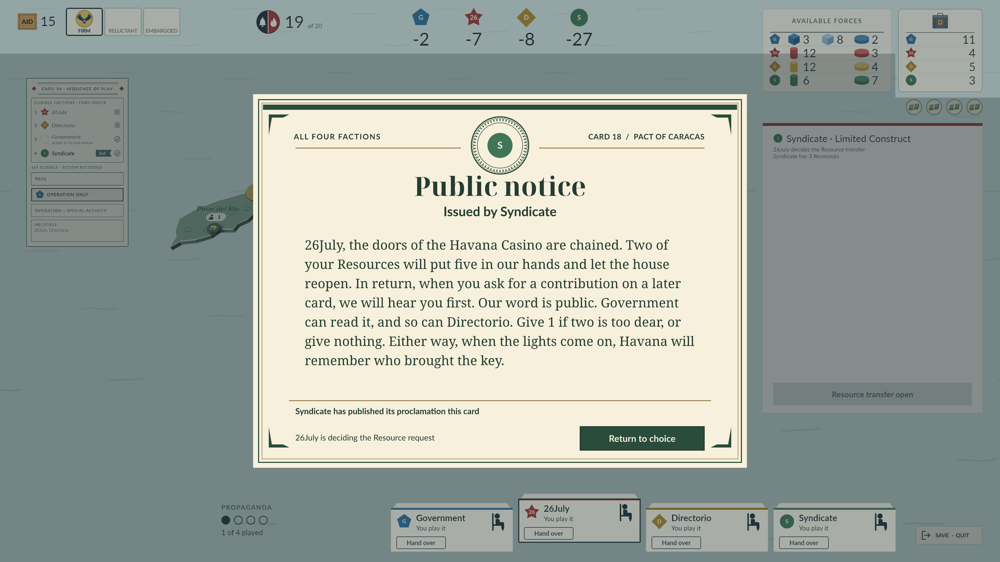
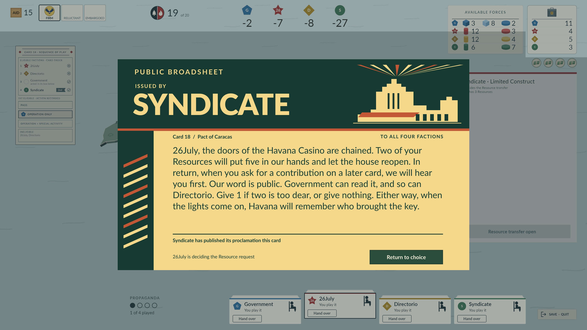
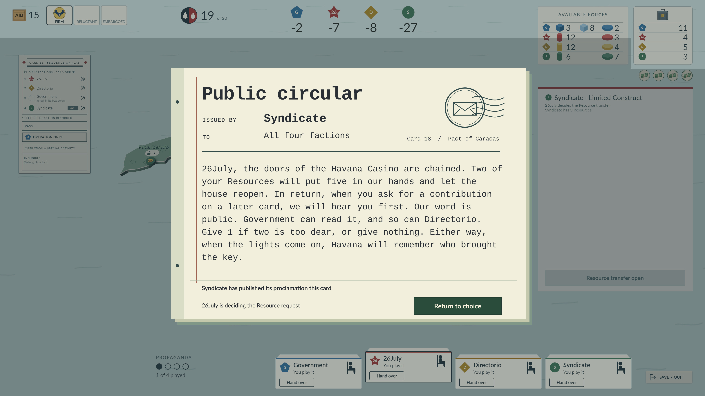
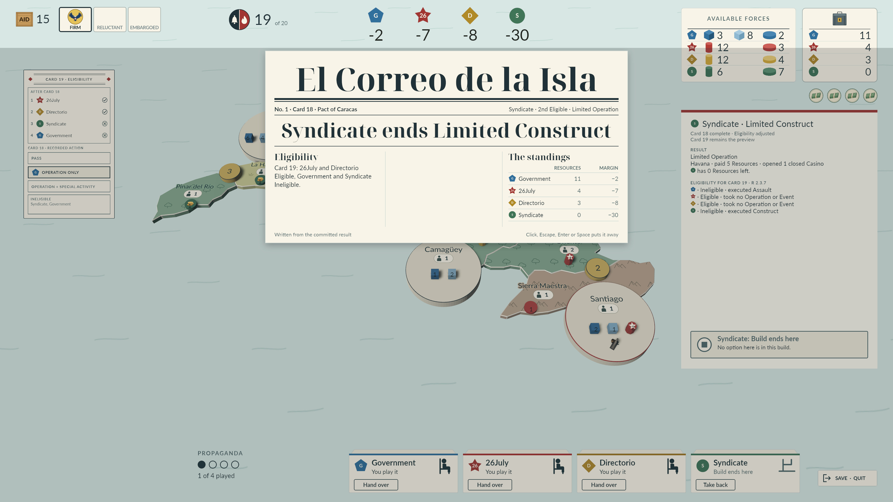

# A public offer in Havana

Syndicate wants 2 Resources from 26July to help reopen the Havana Casino. Each treatment shows Syndicate composing its offer over the Resource request, then 26July reading it while deciding how much to authorize. The offer and promise are Syndicate's words. The factual edition shown for comparison comes from the end of Limited Construct in the same funding route.

## Choose a treatment

Open the images at their original 3840×2160 size to judge the type. Each row links to four frames in the [editable FigCraft layout](havana-proclamations.figcraft). The 142-character and 400-character versions each show the same wording in the writing field and in the public document. The selection covers the named row's four frames, its VectorCraft plate and the [shared writing and return controls](writing-controls.vectorcraft).

| Treatment | Compose 142 | Compose 400 | Read 142 | Read 400 | Editable plate |
|---|---|---|---|---|---|
| Notice | [Draft](notice-compose-142.jpg) | [At the limit](notice-compose-400.jpg) | [Offer](notice-read-142.jpg) | [Full offer](notice-read-400.jpg) | [Engraved notice](notice.vectorcraft) |
| Broadsheet | [Draft](broadsheet-compose-142.jpg) | [At the limit](broadsheet-compose-400.jpg) | [Offer](broadsheet-read-142.jpg) | [Full offer](broadsheet-read-400.jpg) | [Two-ink handbill](broadsheet.vectorcraft) |
| Circular | [Draft](circular-compose-142.jpg) | [At the limit](circular-compose-400.jpg) | [Offer](circular-read-142.jpg) | [Full offer](circular-read-400.jpg) | [Carbon stationery](circular.vectorcraft) |

| Notice | Broadsheet |
|---|---|
|  |  |
| **Circular** | **Factual edition** |
|  |  |

- **Notice.** A seal carries the accepted Syndicate emblem above “Issued by Syndicate.” The engraved border and centered title give the promise the formality of an undertaking. Its 50 px Noto Serif body takes seven lines at the limit. The seal takes vertical space, and the formal voice can lend the issuer an air of authority.
- **Broadsheet.** Syndicate's name occupies the largest line. Two inks, the Havana facade and the hand-cut margin make it read as a posted handbill. Its single column of 58 px Lato fits the long offer in six lines. It takes the most board width and gives the author's name more visual weight than the other treatments.
- **Circular.** Sender and recipients occupy address lines beside a cancellation mark. The filing margin and visible carbon copy make the paper look circulated. Its 47 px Liberation Mono body takes eight lines. The typewriter spacing gives the shortest lines and leaves the least spare vertical room at 400 characters.
- **Factual edition.** *El Correo de la Isla* prints the result, standings and eligibility in multiple columns. Its publication name, headline and “Written from the committed result” belong to the game. Each proclamation instead gives one faction a byline and the entire document for its own speech. The documents keep that attribution when the sender's text itself claims otherwise. [Established edition design](../../atlas/NEWSPAPER.md)

## Source and export custody

The FigCraft frame names match the JPEG basenames for all twelve alternatives. The factual frame is named `Factual edition · Syndicate ends Limited Construct`. Each screen JPEG is a scale-1 export at quality 93. The three named VectorCraft documents each supply their `-plate.png` at scale 1. In `writing-controls.vectorcraft`, artboards in order export `primary.png`, `secondary.png`, `notice-field.png`, `broadsheet-field.png` and `circular-field.png`. The control labels, issuer, message, allowance and counter are editable FigCraft text. Type styles and ink variables are in the FigCraft file.

The table references come from the verified card 18 partial-funding route for #222 at `6c6b8ae`. In the first two images, Syndicate has 3 Resources and needs 2 more for the 5-Resource payment. In the reader's background, 26July is considering authorizing 1. The complete card tray was blanked in all three references before embedding. The other placed images are the eight graphics above, the existing Atlas newspaper scrim and the Syndicate victory emblem. All images are embedded in the layout.

FigCraft CLI 0.18.1 and VectorCraft CLI 0.24.1 were installed on 2026-11-22 from clean checkouts of `storytold/figcraft@5c2a3784` and `storytold/vectorcraft@88f5ece1`. Attribution to those revisions is based on the checkouts' reflogs and executable timestamps. The fonts used for the sheets are from Ubuntu's `fonts-lato` 2.015-1build1, `fonts-noto-core` 20201225-2build1 and `fonts-liberation` 1:2.1.5-3build1. The wrapped lines and final punctuation were inspected at export size. Reopening the moved sources reproduced all thirteen screen exports and eight graphics byte for byte.

The owner selects the exact treatment on [#228](https://github.com/joeloverbeck/cuba-libre-unfolded/issues/228). The implementation and owner playtest of the selected treatment belong to [#227](https://github.com/joeloverbeck/cuba-libre-unfolded/issues/227).
