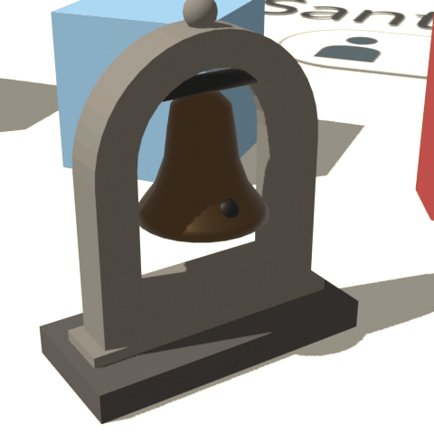
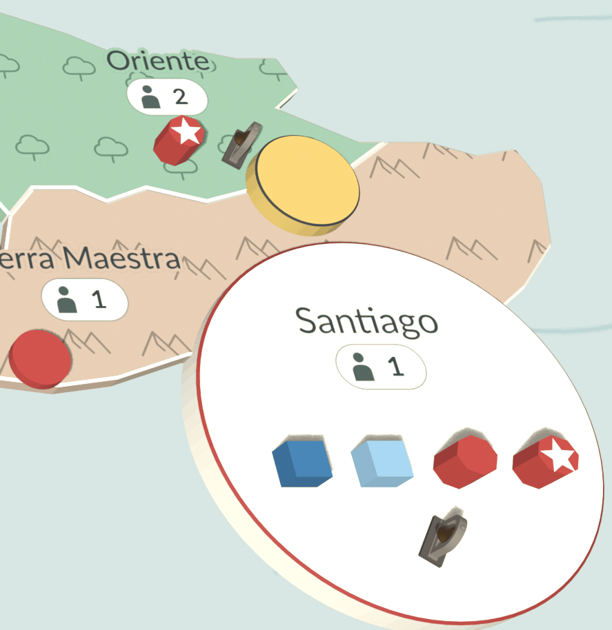
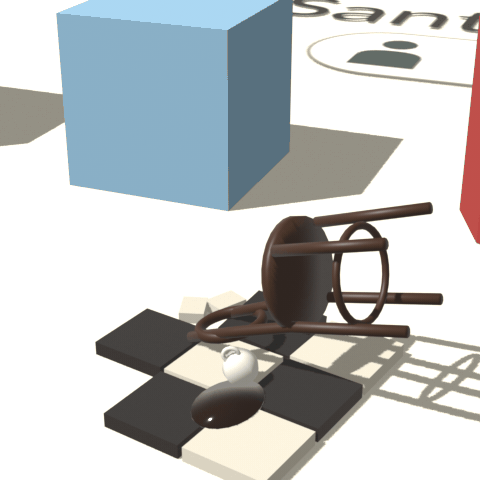
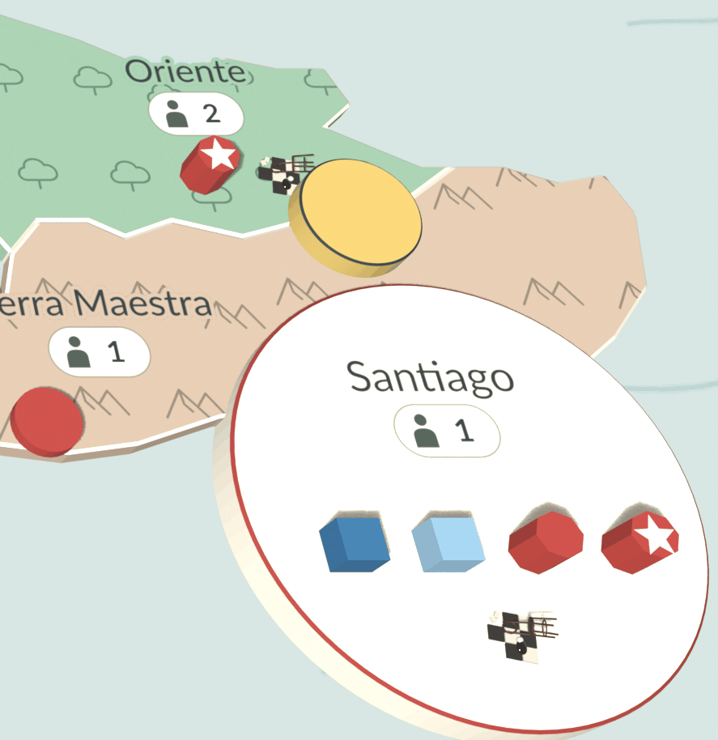
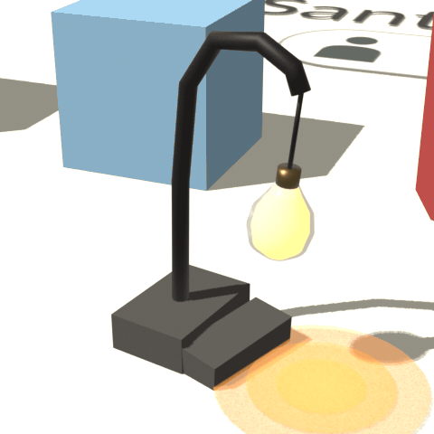

# Terror token alternatives

These are decision-only studies for [#41](https://github.com/joeloverbeck/cuba-libre-unfolded/issues/41). None of them is adopted for production. Each is a dedicated 3D Terror marker modelled and animated in Blender, with a seamless 3.6 s loop.

**Rules basis.** Terror markers stack in a City or Province (R 3.3.4), and the Government's Reprisal places the same marker. So each design shows a climate of fear in a space, not a bomb and not any faction's emblem.

**Shared constraints:**
- No fire, smoke or starburst. Those images are kept for a future Sabotage token.
- No faction hue on the body.
- About a Guerrilla's height and footprint.
- The quantity comes from the plain count label. The token looks the same at any count.

## The alternatives

Each alternative has three loops and one still:
- a close-up;
- a crop of the default Home framing at the app's 1× scale;
- the same crop at 3×, roughly the owner's 6144-pixel display;
- a whole-map still.

### A — Rebato bell (recommended)

  

`a-rebato-bell-*`: a small colonial bell gable (*espadaña*) in smoke-stained limewash on a dark stone plinth. Its bronze bell swings through the arch in alarm, and the clapper trails behind it. *Tocar a rebato* is the old custom of ringing the bell to rouse a town against danger. The swing amplitude itself rises and falls once per loop, so the alarm never settles into a metronome.

- **Meaning.** The most direct of the three: the whole town is alarmed, without saying who caused it. It fits cities and countryside alike.
- **Readability.** It has the strongest single outline: an arch is unlike any cube, octagon or disc on the map. At 1× it reads as a compact dark mark, and the swing is barely visible. At 3× the arch and the swinging bell are clear.
- **Density.** Low. It is one vertical object on a 0.23 × 0.10 plinth.
- **Atmosphere.** Colonial, period-specific and solemn. It could read as "church" before "fear"; the restless swing is what carries the alarm.

### B — Overturned chair

  

`b-overturned-chair-*`: a bentwood café chair knocked onto its back on a patch of black-and-white café tiles. One tile is tilted, two have broken off, and spilt coffee pools on the floor. The chair rocks on its back and never comes to rest, while a demitasse rolls back and forth.

- **Meaning.** Ordinary life interrupted. It is the most human and least militant of the three.
- **Readability.** The tile pattern is the highest-contrast mark at 1×. At that size, though, it can read as a chessboard or a checkered flag before it reads as a chair. At 3× the overturned chair and the rocking are clear.
- **Density.** The highest: tiles, shards, chair, cup and puddle within 0.27 × 0.22.
- **Atmosphere.** Quiet unease rather than alarm. It is strongly urban, which suits Havana and Santiago better than the provinces.

### C — Swinging bare bulb

  

`c-swinging-bulb-*`: a bare bulb on its cord, hanging from a bent iron bracket set in cracked dark stone.
- **Swing:** the bulb sways in a slow ellipse, and its pool of light slides across the ground.
- **Dimming:** once per loop it dims unevenly, sagging and then sputtering twice, before recovering. The dimming is smooth and never strobes.

- **Meaning.** Blackout, interrogation and frayed nerves. It belongs to no side, since either side can bring the dark.
- **Readability.** Light carries the motion, so the dimming is the largest visible change of the three when zoomed in. On green or tan provinces the warm pool reads well. On the cream city plateaus it nearly disappears, and at 1× only a faint glow remains. A glow could also be mistaken for a hover or selection highlight.
- **Density.** Low. It is one thin bracket and a moving pool.
- **Atmosphere.** The most cinematic of the three: 1950s noir, with dread rather than spectacle.

### Recommendation

I recommend **A**. It has the clearest outline at every scale and the most direct meaning. Its motion reads as alarm once the token is large enough to see.

- **C** is the better choice if motion matters more than outline. It loses on the cream city discs, where Terror is often placed.
- **B** is the most humane, but at 1× it risks reading as a board-game pattern.

## Honest limits of these previews

- **The default framing is small.** At the app's default framing (1300 × 684 viewport), a token is about 20–25 pixels tall, and **no animation is clearly visible at 1×**. At that size the token's identity rests on its outline and dark mass. The motion becomes legible at about 3× (the owner's display) or when zoomed in.
- **The scene is reconstructed in Blender, not captured from the app:**
  - the map is the real `atlas-terrain-map.glb` and its region labels;
  - pieces are stand-ins with the app's sizes and colours, in the state after both Terror resolutions;
  - the sea shows its first frame only, without its animation;
  - one sun approximates the app's directional and ambient light, under the Standard view transform (no tone mapping);
  - the UI count labels are absent.
- **Gameplay-scale captures come later.** Real in-app captures are part of the production step, after selection.
- **GIF limits colour.** The 256-colour palette dithers the glow and the polished surfaces; the app has no such limit.
- **Phase offset.** Santiago's token starts at loop frame 0 and Oriente's at frame 33, showing that the per-space offsets keep them out of step.
- **Correction, after selection.** These previews used the camera transform in the app's `setup()`, not its `Orbit` home pose, which is about 9% closer with a shifted target. They were also lit about 1.65× too bright. The calibrated [`art/stage/preview-stage.blend`](../../stage/README.md) fixes both for future proposals. The owner selected A from these previews, then accepted the integrated bell after running the app.

## Evidence

- **Seamless.** For every view of every alternative, the frame one loop later (frame 90) renders pixel-identical to frame 0 (identical decoded-frame MD5). The step from frame 89 back to 0 is as small as ordinary mid-loop steps (PSNR 23.7–30.5 dB, against 24.3–31.6 dB mid-loop). All motion uses whole-number repeats of the 3.6 s loop and smooth periodic windows, with no random noise.
- **Exportable to the app.** All animation is node rotation, translation and scale, keyed every frame. A probe export of each token collection to glTF 2.0 produced:
  - rotation channels (A, B), plus scale and translation (C);
  - 91 keys over exactly 3.6 s, with the last key equal to the first.

  The bulb's dimming is a scaled emissive core, and its light pool is three translucent emissive discs. Neither depends on a material animation that glTF or Bevy might not play.
- **What production still needs.** The app will need Bevy's `bevy_animation` feature, which is not currently enabled. Production also merges each token's per-object clips into one clip, plays it on the development seat's manual clock, and verifies the transparent and emissive materials natively.

## Sources and provenance

`terror-token-proposals.blend` is the editable source:
- **Contents:** the collections `Token_A_rebato_bell`, `Token_B_overturned_chair` and `Token_C_swinging_bulb`, each one token with its loop baked into keyframes.
- **Scene settings:** frames 0–89 at 25 fps.
- **Scale:** the tokens carry the scale used in the previews: 1.1, and 0.82 × 1.1 for B so that its swept footprint stays below a Base's.
- **Swept extents:**
  - A: 0.23 × 0.25 × 0.27
  - B: 0.27 × 0.22 × 0.18
  - C: 0.19 × 0.15 × 0.26 (excluding its light pool)

Blender 5.2.3 LTS built the geometry and keys by mechanical construction from primitives, lathes and tubes. It was operated as an external editor through its Python API, as the Atlas map was, and no generator script is part of this repository. The previews were rendered with EEVEE.

No original board, token or Pictures-collection art was used. The physical counter's maroon starburst was deliberately not reproduced.

## Selection

The owner selected **A, Rebato bell**, in [#41](https://github.com/joeloverbeck/cuba-libre-unfolded/issues/41#issuecomment-6923299180), and noted that in some frames the clapper showed through the bell. In this proposal the bell is solid with a shallow cavity, so the lagging clapper ball penetrated its wall. The production bell is a hollow shell whose clapper is limited by the bell's inner surface, checked on every frame. See [TERROR.md](../../atlas/TERROR.md). B and C remain proposals only, and these files are not runtime inputs.
