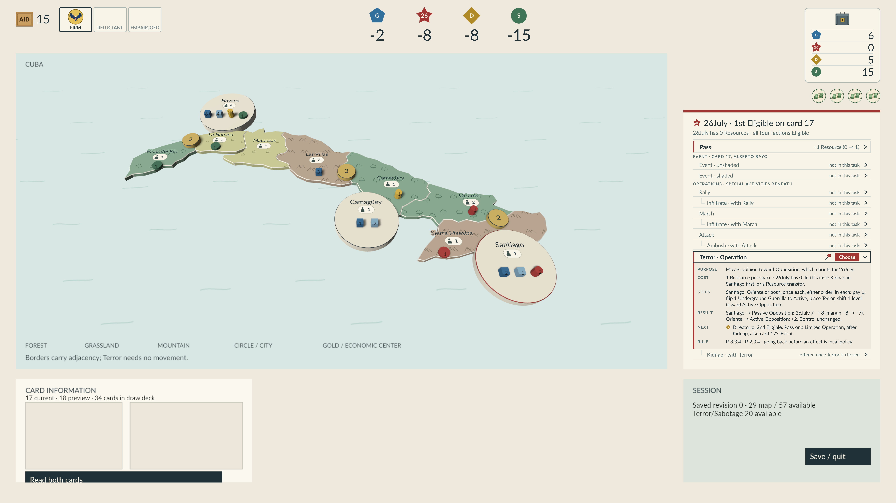
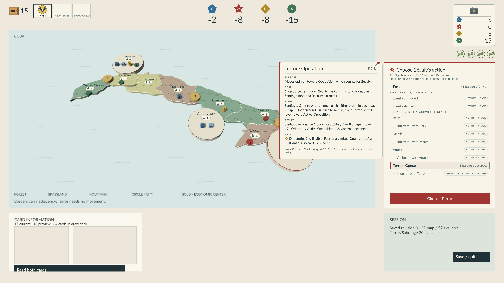
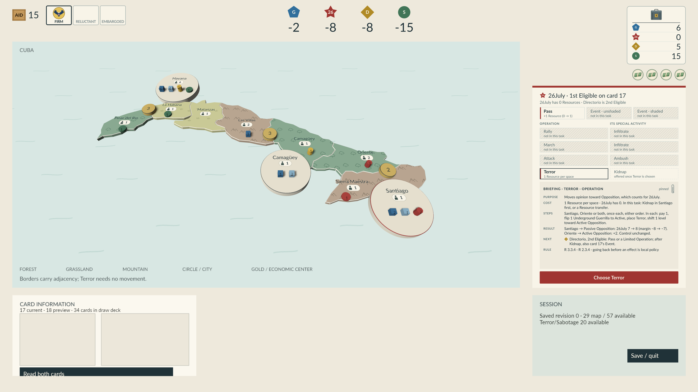
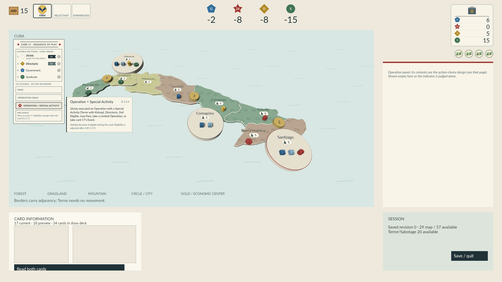
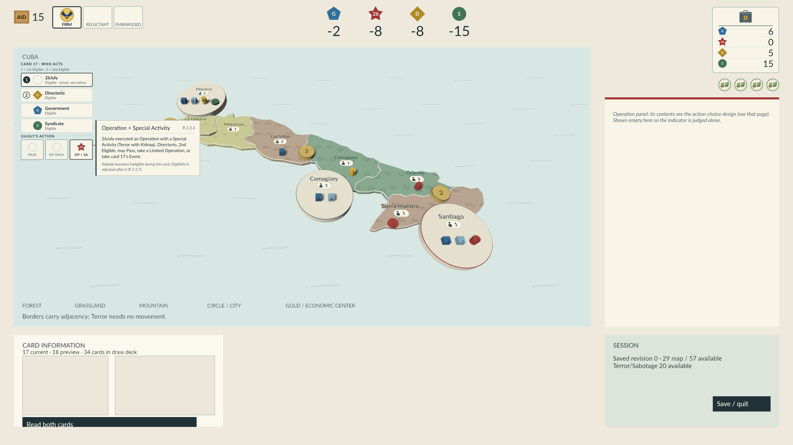
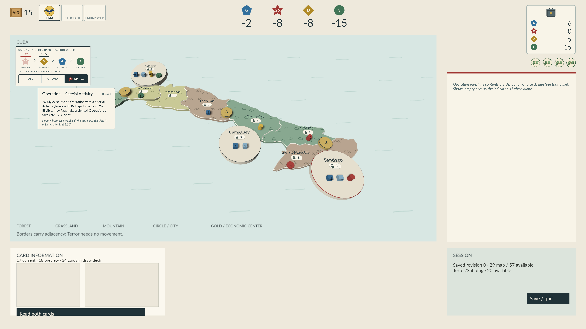

# Action choice and eligibility indicator alternatives

These are decision-only studies for [#64](https://github.com/joeloverbeck/cuba-libre-unfolded/issues/64), part of spec [#58](https://github.com/joeloverbeck/cuba-libre-unfolded/issues/58). The owner chooses among them in #58's combined design round (#68). Nothing here is adopted, and nothing changes in production: no runtime code, save, admission manifest or hash file reads these files.

**Authority and constraints.**
- **[Foundation 4](../../../docs/foundation/04-art-and-assets.md):** three competent, distinct alternatives per design; FigCraft for layouts and VectorCraft for graphics; the `.figcraft` source owns structure, placement, size and spacing; a 16:9 frame for the owner's 6144×3456 display.
- **[`docs/agents/art-tools.md`](../../../docs/agents/art-tools.md):** hover tags are layouts; the animated-mesh checks do not apply (nothing here moves).
- **Accepted components reused, not redrawn:** the four faction emblems (`atlas-victory-icon-*.png`), the 26July victory tag plate (`atlas-victory-tag-26july.png`), the status leader (`atlas-status-leader.png`), the `Atlas` colour variables and Lato, and the top display, card and session panels as context.
- **Inline emblems** follow #60's rule in [`../../atlas/VICTORY.md`](../../atlas/VICTORY.md#inline-text-emblems): drawn at 0.9× the type size on the baseline, with the faction's full name at its first mention in a briefing. No emblem sits on a red surface in any alternative, so #60's provisional rule (26July keeps its name on red buttons) is never exercised here: every red primary button reads "Choose Terror" or "Pass", with no faction. The rule itself is #68's question.

**Content.** All text is card 17's real position and the facts #61 implemented on the integration branch (`src/game.rs`, `opening_choices` and the observation):
- **Option list,** in #61's order: Pass; the Event's unshaded and shaded texts; Rally with Infiltrate, March with Infiltrate, Attack with Ambush; Terror with Kidnap. All but Pass and Terror are "not in this task". Kidnap is "offered once Terror is chosen".
- **Pass:** +1 Resource (0 → 1), 26July stays Eligible, Directorio becomes 1st Eligible with Pass, an Operation with or without a Special Activity, or the Event; the task ends there (R 2.3.3).
- **Terror:** 1 Resource per space, 26July has 0; funded in this task only by Kidnap in Santiago first or a Resource transfer. Santiago → Passive Opposition: 26July 7 → 8, margin −8 → −7; Oriente → Active Opposition: +2; Control unchanged (R 3.3.4). Directorio as 2nd Eligible: Pass or a Limited Operation, plus card 17's Event after Kidnap (R 2.3.4, 5.2).
- **Kidnap:** Santiago only; proceeds 1–6 while Government has 6, at least 1; the shaded Event text "All 26July Guerrillas Active. 26July Ineligible through next card" (R 4.1, 4.3.3).
- **Eligibility:** card 17's order 26July, Directorio, Government, Syndicate; all four Eligible throughout; the box 26July's action records (Pass, Operation Only, Operation with Special Activity) is empty until the action is recorded, so it stays empty during Terror (#61's `m26_box`); nobody becomes Ineligible inside the task (R 2.3.7).
- **Local policy is labelled as local policy:** going back to the choice before the first effect, and the accepted zero-space Operation Only reading.

Briefings state facts and computed consequences only; none recommends a move.

## What all alternatives share

- **Frame:** each alternative has a 6144×3456 frame copied from the accepted [`../../atlas/atlas-top-display.figcraft`](../../atlas/TOP.md) (not modified): top display, standings and panels in place, at 2.7× the 1920×1280 reference.
- **Context, reference only:** the map, card and session areas are locked crops of a native 3840×2160 seat capture, `local/verification/issue-46/seat-top-16x9/rest.png` (SHA-256 `369887ae…0671`). They are not designs. The capture predates #61, so its panels are replaced or left empty here.
- **Built at reference size, then scaled 2.7×:** every panel, tag and indicator was laid out with auto layout at 1920×1280 reference units and scaled as a whole. Reference sizes in this README are those units; the owner's display is 2.7× them.
- **States sheets:** each alternative also has a sheet of its other states (scaled the same way, exported at half size).
- **Reminder control:** each action-choice alternative has its own way to reopen the Terror and Kidnap briefings during execution. The execution controls themselves (targets, Kidnap opening, transfers, End Terror) belong to #62, #65 and #71 and appear only as a dashed placeholder.

## Design 1: the action choice with briefings

All three keep the accepted operation panel's place and size (500×660 at the reference, top-right under the ledger). They differ in where the briefing lives.

### AC-A — Accordion ledger

[Panel at owner scale](ac-a-accordion-panel.png) · [states](ac-a-accordion-states.png)

The option list is one ledger. Hovering or focusing a row opens its briefing **in place**, under the row; clicking pins it (the red pin), and the other rows stay closed. A playable row that is open carries its own commit button ("Choose" for Terror, "Pass" for Pass). Section labels group the card's Event and the Operations, with each Special Activity indented under its Operation by a connector. During Terror, a **seal** beside the panel heading reopens the Terror and Kidnap briefings in the same place.

- **Why it suits the task:** the answer to "why would I do this now?" appears exactly where the eye already is, and the commit sits next to the facts it commits to.
- **Readability:** good; briefing text is 12.5 px at the reference (34 px on the owner's display). The briefing is the narrowest of the three (about 350 px of text width), so long lines wrap to three lines.
- **Information density:** the highest in one place; the whole option set and one briefing fit the panel without scrolling, but only just (the Kidnap row ends 24 px above the panel foot). A longer briefing would push Kidnap out of view.
- **Atmosphere:** a quiet ledger; the paper and rules match the accepted Atlas desk closely. Little period flavour.
- **Risk:** the rows below an open briefing move when it opens or closes.

### AC-B — Briefing tag

[Panel and tag at owner scale](ac-b-briefing-tag-panel.png) · [states](ac-b-briefing-tag-states.png)

The panel stays a fixed list: larger rows, and a "NOT IN THIS TASK" pill on each unavailable option. The briefing opens as a **tag on the accepted 26July tag plate**, 8 px left of the panel and top-aligned with it (the accepted Resources-tag placement rule). A pushpin through the tag's corner shows it is pinned. Commit is the accepted full-width primary action at the panel's foot, labelled for the selected option ("Choose Terror", "Pass · +1 Resource"), and disabled with the reason for an option not in this task. During Terror a red **BRIEFING ribbon** hangs from the panel's top edge; clicking it reopens the tag, with Terror and Kidnap tabs.

- **Why it suits the task:** the list never moves, and the briefing reuses the accepted hover-tag language, so it reads as the same family as the standings and top-display tags.
- **Readability:** the best of the three; briefing text is 15 px at the reference (40.5 px on the owner's display), with each heading above its text.
- **Information density:** the lowest in the panel, and the briefing spends screen area outside it. The tag is shown at the accepted plate's authored size (468×440); the runtime stretches the plate to content, as the top display's tags do.
- **Atmosphere:** the most consistent with accepted art (tag plate, faction stripe, leader); the pin and ribbon add a tactile, paper-desk touch.
- **Risk:** the tag opens over the map's east, covering Oriente's eastern tip and the top of Santiago while it is open; those are the Terror targets. The camera can pan, and the tag closes when unpinned.

### AC-C — Order sheet

[Panel at owner scale](ac-c-order-sheet-panel.png) · [states](ac-c-order-sheet-states.png)

The options become a sheet: Pass and the Event's two texts as three cells, then a two-column grid of each Operation beside its Special Activity (Rally | Infiltrate, March | Infiltrate, Attack | Ambush, Terror | Kidnap). Options not in this task are hatched (a VectorCraft hatch); Kidnap's cell is dashed because it becomes available once Terror is chosen. Below the grid a **fixed briefing pane** shows the focused option and holds it when pinned (the paperclip); the primary action sits under it. During Terror the pane stays at the panel's foot as a **Terror | Kidnap tab strip** and opens upward.

- **Why it suits the task:** the grid makes the rule "a Special Activity goes with its Operation" visible as structure, and the pane never moves or covers the map.
- **Readability:** good; briefing text is 12 px at the reference (32 px on the owner's display), with a wider measure than A. Cell notes are small (10.5 px at the reference, 28 px on the owner's display).
- **Information density:** high; the whole option set reads at a glance, and the pane has room to spare for longer briefings.
- **Atmosphere:** the most like a period operations order or form; the hatching reads as "struck out" without hiding the option.
- **Risk:** hatching lowers the contrast of unavailable cells, by design; their briefings are still one hover away.

## Design 2: the left-margin eligibility indicator

All three sit in the map's western sea, below the "CUBA" heading, where the native framing leaves the margin empty; none takes picks from a region. The 16:9 frames show the state after End Terror with Kidnap, with the hover tag of the occupied box; the states sheets show the opening (unchanged all through Terror), after Pass, and after Operation Only, each with its box's hover. Hover tags use the accepted top-display tag geometry; in FigCraft they are drawn as a paper rectangle with an ink stripe standing in for `atlas-top-tag.png`, which the runtime stretches to content.

### EL-A — Sequence track

[Close-up at owner scale](el-a-sequence-track-closeup.png) · [states](el-a-sequence-track-states.png)

A board-like strip: a ruled header with red diamonds ("CARD 17 · SEQUENCE OF PLAY"), then boxes as on a COIN sequence-of-play track. The Eligible box lists the four factions in card order, each with its emblem, name, an Eligible check and the **1st / 2nd ribbons**. Below are the three boxes 26July's action can occupy: Pass, Operation Only, Operation + Special Activity. When 26July acts, its emblem moves into the box and its row shows a dashed empty slot ("acted: in its box below"), still checked Eligible. An Ineligible box stays empty with the reason (R 2.3.7).

- **Why it suits the task:** it teaches the Sequence of Play itself; every box the rules name is visible, including the empty Ineligible one.
- **Readability:** names and labels are 12 and 8.5–10 px at the reference (32 and 23–27 px on the owner's display); the caps labels are the smallest text in either design.
- **Information density:** the highest; about 232×380 at the reference. It reaches toward Pinar del Río's western tip.
- **Atmosphere:** the strongest board-game character; reads like the physical game's track, drawn new.

### EL-B — Order ladder

[Close-up at owner scale](el-b-order-ladder-closeup.png) · [states](el-b-order-ladder-states.png)

Four rungs in card order, each a paper card with a large emblem, the faction's name and "Eligible". Round **1 / 2 badges** mark the 1st and 2nd Eligible, and a one-line legend says so. Under the ladder, three square boxes (PASS, OP ONLY, OP + SA) hold 26July's emblem once it acts; its rung keeps a dashed slot. No backing plate: the rungs sit directly on the sea.

- **Why it suits the task:** "who acts next" is the first thing read; the boxes are a compact second line.
- **Readability:** the best of the three; emblems are 28 px and names 12.5 px bold at the reference (76 and 34 px on the owner's display).
- **Information density:** medium; no Ineligible box (nobody is Ineligible on card 17; the hover says when that changes).
- **Atmosphere:** clean and modern; the least period character.

### EL-C — Card band

[Close-up at owner scale](el-c-card-band-closeup.png) · [states](el-c-card-band-states.png)

A small card-shaped plate in the top-left corner that echoes card 17's faction-order band: "CARD 17 · ALBERTO BAYO · FACTION ORDER", then the four emblems in a row joined by chevrons, each marked ELIGIBLE beneath, with **1ST** (red rule) and **2ND** (ink rule) above. Below, a three-segment strip (PASS | OP ONLY | OP + SA) fills the segment 26July occupies with ink and its emblem; 26July's emblem in the band ghosts to 30% when it has moved.

- **Why it suits the task:** it ties the order directly to the card the player holds and takes the least space.
- **Readability:** emblems 32 px at the reference (86 px on the owner's display); the ELIGIBLE marks are 8 px (22 px), the smallest text in this design.
- **Information density:** the most compact (292×157 at the reference) and horizontal; the order reads left to right, as on the card.
- **Atmosphere:** card-like; ties to the physical card's order band without copying it.

## Recommendations

- **Action choice: AC-B, the briefing tag.** It is the most legible, keeps the list still, and reuses accepted tag art. Its cost is covering the eastern map while a tag is open. **AC-C** is the better choice if covering the map is unacceptable; **AC-A** if keeping everything in the panel matters most.
- **Eligibility indicator: EL-A, the sequence track,** for teaching the Sequence of Play to a player who could not read the task. **EL-B** if legibility at a glance matters more; **EL-C** if margin space matters most.

These are proposals; the owner decides in #68.

## Checks

- **Sources reopen:** after moving the files from the main checkout to this worktree, both sources reopened from the worktree path. FigCraft: 2 pages, 2001 layers, 32 embedded images, no repairs. VectorCraft: no missing or modified links, no warnings. Both rendered.
- **Exports inspected:** every 16:9 frame, close-up and states sheet was rendered and looked at; text fits its boxes at the stated sizes.
- **No production change:** the only files added are under `art/proposals/issue-64/`. No application code, save, manifest or hash file changes.
- **No borrowed art:** nothing from the Pictures collection. The context crops come from this project's own seat capture.
- **Card faces blanked:** the card-information panel's two card slots are empty, because the private card faces stay out of Git; see #51.
- **Animated-mesh checks:** n/a; nothing here moves.

## Honest limits

- **Not native captures.** Layout, type and colour are FigCraft renders over a native capture of the map; Bevy's text rendering will differ.
- **Legibility at 6144×3456** is shown by full-size exports, not by the owner's display; that stays with #16.
- **Hover-tag plates:** AC-B's tag uses the accepted plate at its authored size; the eligibility hover tags use a FigCraft stand-in for `atlas-top-tag.png`. The runtime stretches the accepted plate in both cases.
- **The execution panels are placeholders** for #62, #65 and #71's content; only the reminder controls are designed here.
- **`mark-ineligible`** is drawn for later cards but unused: nobody is Ineligible on card 17.

## Sources and provenance

- **`action-choice-eligibility-layouts.figcraft`** (FigCraft CLI 0.18.1): page **Action choice** with frames AC-A, AC-B, AC-C and their states frames; page **Eligibility indicator** with EL-A, EL-B, EL-C and theirs.
  - Colour variables are the accepted `Atlas` collection plus `action/primary` (#A03531, the accepted operation-panel bar and primary-button red).
  - Text styles `Choice/*`, `Briefing/*`, `Tag/*`, `Indicator/*` and `Hover tag/*` record the type sizes at owner scale; the accepted `HUD/*` styles are kept.
- **`briefing-eligibility-graphics.vectorcraft`** (VectorCraft CLI 0.24.1): 16 artboards, drawn at reference size and exported at 3× into `graphics/`:
  - action choice: `pin`, `reminder-seal` (A), `reminder-ribbon` (B), `paperclip` (C), `chevron-closed`, `chevron-open` (A), `not-in-task-hatch` (C);
  - indicator: `track-header`, `tag-1st`, `tag-2nd`, `mark-eligible` (A), `mark-ineligible` (drawn for later cards, unused on card 17), `badge-1`, `badge-2`, `slot-vacant` (B, reused by A), `order-chevron` (C).
- **Exports:** `*-16x9.png` at 6144×3456; `*-panel.png` and `*-closeup.png` at owner scale; `*-states.png` at half owner scale.
