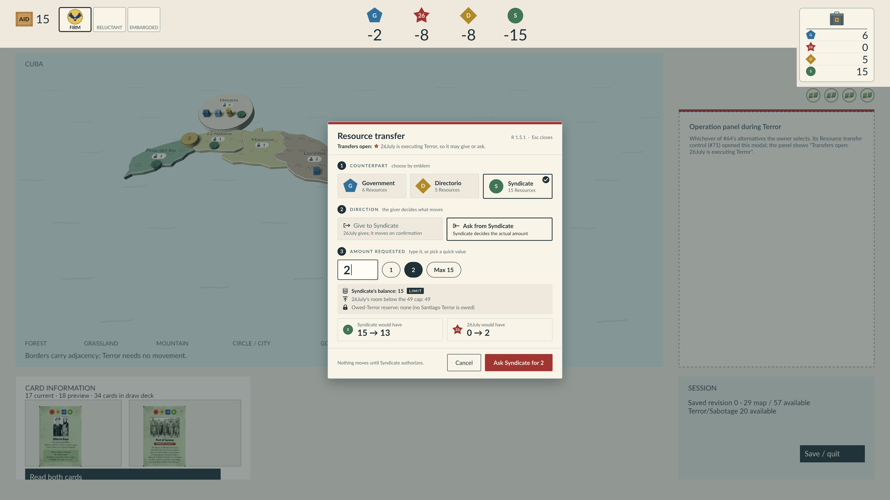
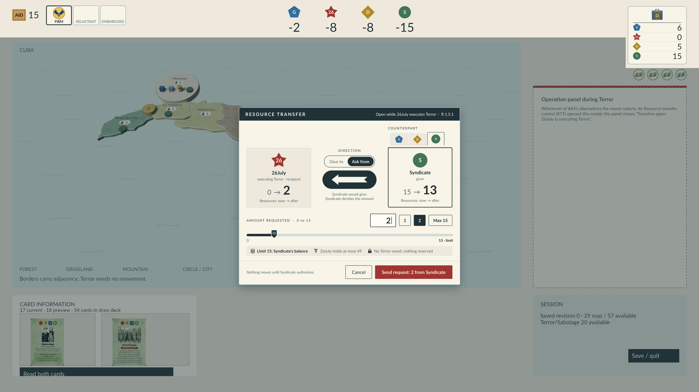
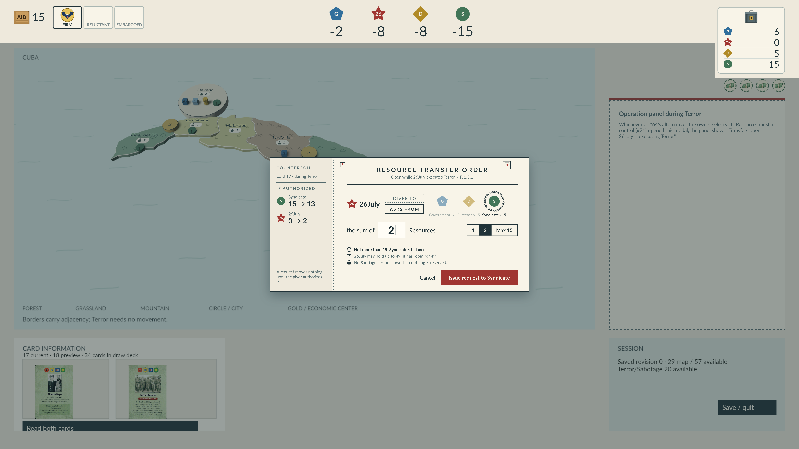

# Resource transfer modal alternatives

These are decision-only studies for [#65](https://github.com/joeloverbeck/cuba-libre-unfolded/issues/65), part of spec [#58](https://github.com/joeloverbeck/cuba-libre-unfolded/issues/58). The owner chooses among them in #58's combined design round (#68). Nothing here is adopted, and nothing changes in production: no runtime code, save, admission manifest or hash file reads these files.

**Authority and constraints.**
- **[Foundation 4](../../../docs/foundation/04-art-and-assets.md):** three competent, distinct alternatives; FigCraft for layouts and VectorCraft for controls; the `.figcraft` source owns structure, placement, size and spacing; a 16:9 frame for the owner's 6144×3456 display.
- **[`docs/agents/art-tools.md`](../../../docs/agents/art-tools.md):** a modal is a layout; the animated-mesh checks do not apply (nothing here moves).
- **#58, "Transfer modal":** a centred modal that keeps the four standings visible and blocks camera and map input; counterpart by emblem; Give to or Ask from; amount typed or by the quick values 1, 2 and Max, with the bound and both resulting balances live; Give confirms at once; Ask hands the modal to the giver's decision in the giver's colours (actual amount prefilled with the request, Authorize, Decline, Wait); a reserved state for a request another faction starts.
- **Consistency with the merged proposals:** the same `Atlas` colour variables, `action/primary` and Lato as [`../issue-64/`](../issue-64/README.md), the same base frame (copied from the accepted [`atlas-top-display.figcraft`](../../atlas/TOP.md), not modified) and the same 2.7× reference scale. Nothing here presupposes which of #64's action-choice alternatives the owner picks: the operation panel is a labelled dashed placeholder under the scrim.
- **Inline emblems** follow #60's rule in [`../../atlas/VICTORY.md`](../../atlas/VICTORY.md#inline-text-emblems). 26July keeps its name wherever its colour is the surface: "26July decides", "26July authorizes 2" and "26July countersigns" are written on red, with no 26July emblem on red. That rule is still provisional and is #68's question.

## Rules basis and content

**R 1.5.1 (Living Rules, March 2019):** "Players … may voluntarily transfer only Resources (1.8) or Cash (4.5.2) — Resources only at any time that the giving or receiving Faction is executing an Operation, Special Activity, or Event. … The rules do not bind players to agreements."

All values come from the prepared position and the transfer behaviour on the integration branch (`src/game.rs`, `Transfer::Authorizing` and the `transfer`/`amount`/`authorize`/`decline`/`wait` choices):
- **Prepared position:** Government 6, 26July 0, Directorio 5, Syndicate 15; standings −2, −8, −8, −15. 26July is the executing faction during Terror, so transfers are open with 26July as one endpoint.
- **Bound:** the giver's balance, less 1 when 26July gives while Santiago Terror is owed, and never more than takes the recipient to 49. The modal lists all three limits and marks the one that binds.
- **Kidnap position used for the reserve:** a Kidnap roll of 3 in Santiago (R 4.3.3) moves Government 6 → 3 and 26July 0 → 3, and Santiago Terror is then owed. 26July can give at most 2. The reserve is the accepted commitment policy, which is local policy, not a publisher ruling.
- **Unchanged behaviour shown:** zero and repeated transfers are allowed; a request moves nothing until the giver authorizes it; Wait keeps the request pending across save and quit; Decline returns with nothing moved.

The 49 cap never binds in this position (the richest faction has 15), so every alternative shows it as room, not as the limit.

## What all three alternatives share

- **Frame:** the scrim covers the map, panels and session area to block camera and map input. It leaves the top display clear: the four standings and the Resources ledger stay readable above it. The modal is centred on the 6144×3456 frame.
- **Built at reference size, then scaled 2.7×:** each modal is auto layout at 1920×1280 reference units (masters on the page "Reference-size masters"), scaled as a whole into the frames and sheets. Reference sizes below are those units.
- **States per alternative, each with real values:**
  1. opened, nothing chosen (prepared position);
  2. Give to Directorio after the Kidnap roll of 3, with 3 typed: refused, Max 2, the reserve marked as the binding limit;
  3. the 16:9 frame: 26July asks Syndicate for 2 (Syndicate 15 → 13, 26July 0 → 2; limit 15, Syndicate's balance);
  4. the giver's decision in Syndicate's green: amount prefilled with 2, any amount from 0 to 15, Authorize, Decline, Wait;
  5. the reserved state: Directorio asks 26July for 2 in the Kidnap position, in 26July's red, with 0 to 2 because of the reserve. It is labelled as reserved; nothing in this task creates one;
  6. after Wait: the modal closes and a pending marker sits in the top band, right of the standings; Open returns to the giver's decision.
- **Shared VectorCraft icons** for the three limits: `icon-balance` (giver's balance), `icon-cap` (recipient's 49 cap), `icon-reserve` (owed-Terror reserve), and `icon-wait`.
- **Type:** smallest text is 11 px at the reference (30 px on the owner's display); body text 12–13 px (32–35 px); amounts 26–30 px (70–81 px).

## TM-A — Ledger form

[Modal at owner scale](tm-a-ledger-form-closeup.png) · [states](tm-a-ledger-form-states.png)

A paper dialog with the accepted panel's red bar, read top to bottom as three numbered steps: **1 Counterpart** (three emblem tiles with each faction's balance; the chosen tile gets an ink frame and a tick), **2 Direction** (two option cards, "Give to Syndicate" and "Ask from Syndicate", each saying who decides), **3 Amount** (a number field, then pill quick values 1, 2 and Max n). Below the entry, a limits box lists the three bounds with a LIMIT pill on the binding one, and two balance cells give "would have" values for both factions. The giver's decision recolours the bar and header to the giver and drops steps 1 and 2.

- **Why it suits the task:** it follows #58's flow literally, one step per row, so a first-time player cannot miss a step, and each option says what it means ("Syndicate decides the actual amount").
- **Readability:** good; the largest body text of the three. Every limit is a full sentence.
- **Information density:** the most text and the tallest modal (about 660 reference px, 1777 px on the owner's display). All of it is visible at once, with no hover.
- **Atmosphere:** a quiet form in the Atlas desk's paper and rules; the least period flavour.
- **Risk:** it reads as an ordinary software dialog; the steps cost height and the modal covers the map's centre.

## TM-B — Two accounts

[Modal at owner scale](tm-b-two-accounts-closeup.png) · [states](tm-b-two-accounts-states.png)

A dark header band over two account cards: 26July on the left, the counterpart on the right, chosen by **emblem tabs** on top of its card. Between them a **Give to | Ask from** toggle drives a large **flow arrow** that always points from the giver to the recipient. Each card shows its balance as "now → after" with the result in large type. Below, the amount row (field and square quick values) sits over a **slider** (Bevy's slider widget) whose range is the giver's balance. A unit held back for the owed Santiago Terror is **hatched** on the track; an amount typed into it is refused. A one-line limits strip names the three bounds. In the giver's decision, the band, arrow, slider and giver card take the giver's colour, and the tabs and toggle disappear.

- **Why it suits the task:** the transfer is drawn as movement between two balances, so direction and consequence are read before any text; the hatched unit shows *why* Max is 2.
- **Readability:** the balances are the largest numbers in any alternative (40 px at the reference, 108 px on the owner's display); the limits strip is one line of 13 px text.
- **Information density:** medium; the widest modal (720 reference px, 1944 px on the owner's display) but shallower than A.
- **Atmosphere:** modern and graphic; the dark band echoes the accepted session buttons. Little period flavour.
- **Risk:** two inputs (field and slider) for one value; the tabs are small targets (56×40 reference px).

## TM-C — Transfer order

[Modal at owner scale](tm-c-transfer-order-closeup.png) · [states](tm-c-transfer-order-states.png)

A period printed form: a **counterfoil** stub on the left, torn off along a VectorCraft **perforation**, and an order titled "RESOURCE TRANSFER ORDER" with ornamental corners and a double rule. The order reads as a sentence: "26July **ASKS FROM** [seal] the sum of [2] Resources". The direction is a pair of **stamps** (GIVES TO and ASKS FROM; the chosen one is inked, the other dashed). The counterpart is chosen from three **seals**, with a scalloped ring around the chosen emblem. The amount is a blank on a line, with a tab strip of quick values. The fine print gives the three limits; the counterfoil gives both resulting balances. The giver's decision makes the order a document to **countersign** in the giver's colour: Wait, Decline and "Countersign: authorize 2". The reserved state carries a RESERVED rubber stamp, and Wait leaves a small PENDING slip in the top band.

- **Why it suits the task:** a transfer request is literally a document handed to another faction, which matches "the giver decides"; the reserved state needs no extra explanation, because another faction can issue the same order.
- **Readability:** good for the sentence and the amount (17 and 30 px at the reference). The seal labels are the smallest text in any alternative (11 px, 30 px on the owner's display), and the unchosen seals are faded to 55%.
- **Information density:** the most compact (740×384 reference px, 1998×1037 px on the owner's display); it leaves most of the map's west and east visible beside it.
- **Atmosphere:** the strongest period character: revolutionary bonds and official orders, all invented (no real form, bond or mark is copied).
- **Risk:** the sentence order (direction before counterpart) is less scannable than A's numbered steps; underlined text buttons (Cancel, Wait, Decline) are less obvious than A's and B's boxed buttons.

## Recommendation

**TM-B, the two accounts.** It makes direction and consequence visible before any text, and the hatched reserve explains the Max that confused the owner in #8. **TM-A** is the better choice if explicit step-by-step text matters most; **TM-C** if period character and leaving the map visible matter most.

This is a proposal; the owner decides in #68.

## Checks

- **Sources reopen from the worktree:** after the files were moved from the main checkout, both sources reopened from this folder and rendered.
  - FigCraft: 3 pages, 2773 layers, 50 embedded images, no repairs.
  - VectorCraft: no missing or modified links, no warnings.
  - Neither source contains a path to the main checkout.
- **Exports inspected:** every 16:9 frame, close-up, states sheet and graphic was opened and looked at. Text fits its boxes, and every state carries the values above.
- **No production change:** the only files added are under `art/proposals/issue-65/`.
- **No borrowed art:** nothing from the Pictures collection. The context crops in the base frame are #64's crops of this project's own seat capture.
- **Animated-mesh checks:** n/a; nothing here moves.

## Honest limits

- **Not native captures.** Layout, type and colour are FigCraft renders over a native capture of the map. Bevy's text, slider and text-input widgets will draw differently.
- **Legibility at 6144×3456** is shown by full-size exports, not on the owner's display; that stays with #16.
- **The operation panel is a placeholder.** The control that opens the modal (#71) and the withdrawal of a pending request by going back or ending Terror belong to #64's selected panel. #61 already implements that withdrawal.
- **Cash** is also transferable under R 1.5.1. It is outside #58's scope and is not designed here.
- **The pending marker's place** in the top band is a proposal. It sits clear of the standings and the ledger, but it was not tested against every top-display hover tag.

## Sources and provenance

- **`transfer-modal-layouts.figcraft`** (FigCraft CLI 0.18.1), saved as a copy of #64's source with #64's alternatives removed:
  - **Page Transfer modal:** the 16:9 frames TM-A, TM-B and TM-C, and their states sheets.
  - **Page Reference-size masters:** every modal and marker at 1920×1280 units.
  - **Page VectorCraft graphics (placed):** the imported exports.
  - **Variables:** colours are bound to the `Atlas` collection (`ink`, `ink-secondary`, `paper`, `desk`, `rule`, the four `faction/*` colours) and to `action/primary`.
  - **Text styles:** `Transfer/*` record the type sizes at owner scale; the accepted `HUD/*` styles are kept.
- **`transfer-modal-controls.vectorcraft`** (VectorCraft CLI 0.24.1): 18 artboards, drawn at reference size and exported at 3× into `graphics/`:
  - **Shared:** `icon-balance`, `icon-cap`, `icon-reserve`, `icon-wait`.
  - **TM-A:** `a-step-1`, `a-step-2`, `a-step-3`, `a-selected-tick`, `a-arrow-give`, `a-arrow-ask`.
  - **TM-B:** `b-flow-arrow` (drawn pointing right; turned 180° in the layout for Ask), `b-slider-thumb`, `b-reserve-hatch`.
  - **TM-C:** `c-corner` (turned per corner in the layout), `c-perforation`, `c-seal`, `c-stamp-reserved`, `c-stamp-pending`.
- **Accepted components reused, not redrawn:** the four `atlas-victory-icon-*.png` emblems and the base frame's top display, ledger and context crops.
- **Exports:**
  - `*-16x9.png` at 6144×3456;
  - `*-closeup.png`: the modal at owner scale, 1:1 with the owner's display;
  - `*-states.png`: the states sheets at half owner scale.
