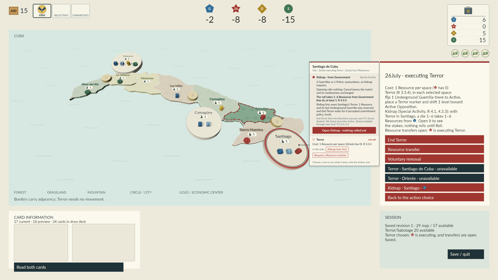
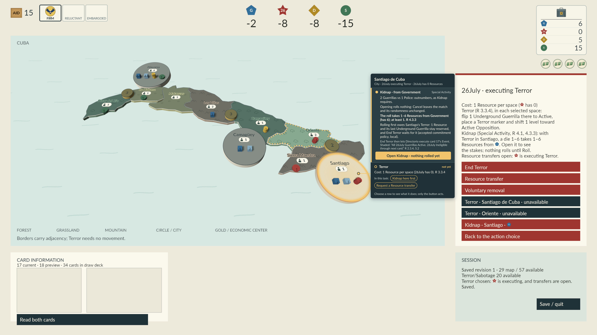
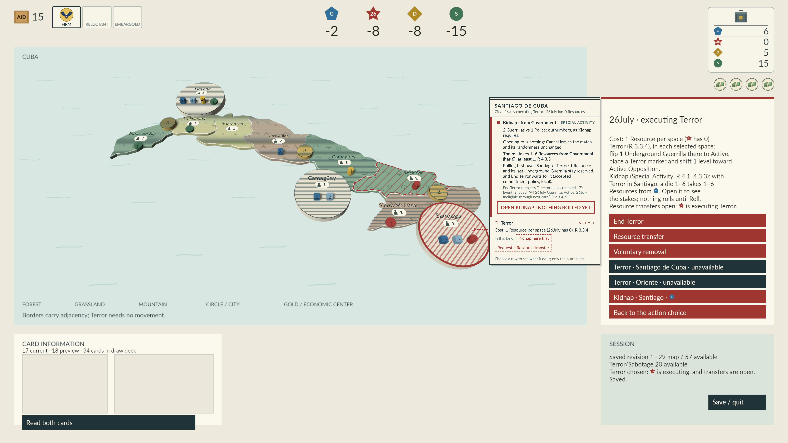

# Map highlight family and popover alternatives

These are decision-only studies for [#66](https://github.com/joeloverbeck/cuba-libre-unfolded/issues/66), part of spec [#58](https://github.com/joeloverbeck/cuba-libre-unfolded/issues/58). The owner chooses among them in #58's combined design round (#68). Nothing here is adopted, and nothing changes in production: no runtime code, save, admission manifest or hash file reads these files.

**Authority and constraints.**
- **[Foundation 4](../../../docs/foundation/04-art-and-assets.md):**
  - three competent, distinct alternatives, shown at useful viewing size;
  - VectorCraft for the graphics, EffectCraft for authored motion, FigCraft for the popover layout;
  - new graphics use the FigCraft palette and type styles;
  - a 16:9 frame for the owner's 6144×3456 display.
- **[`docs/agents/art-tools.md`](../../../docs/agents/art-tools.md):**
  - Blender runs headless as an editor; its scripts and logs stay in `local/verification/issue-66/`, out of Git;
  - the animated-mesh checks apply to the one animated alternative (HF-B), as far as they apply to an opacity loop.
- **#58, "Voluntary removal and map targeting":**
  - space states during Terror: selectable, blocked with a remedy, not involved (dimmed);
  - in removal mode, piece states replace them: removable or protected;
  - one popover per space, listing every action with its preview;
  - a piece popover with the piece, its state and space, a quantity for a stack of more than one, the consequences, and Remove or Cancel;
  - highlights must not hide pieces, count labels or hover tags.
- **Previews come before the committing click** (orchestrator carry-forward from #62). In every popover, choosing a row only shows its preview; a separate button acts.
- **Consistency with the merged proposals:**
  - the same `Atlas` colour variables, `action/primary` and Lato as [`../issue-64/`](../issue-64/README.md) and [`../issue-65/`](../issue-65/README.md);
  - the same 2.7× reference scale.
  - Nothing here presupposes which of their alternatives the owner picks. The operation panel in the frames is the integration branch's current temporary panel, captured natively.
- **26July on red surfaces:** #60's provisional rule (26July keeps its name on red) is never exercised. No red button names a faction; the only red-on-paper text naming 26July is ordinary text, and no emblem sits on red.

## How the alternatives were put on the real map

Each picture is the integration branch's own native render, with the highlights applied to the real 3D Atlas map. Nothing is painted over a screenshot by hand.

1. **Native captures:**
   - The development seat (`cuba-libre --agent-seat --seat-size 3840x2160`, integration tip `92144b1`) drove the actual controls into each state and captured it.
   - Its observations supply every text in the popovers: choices, explanations, remedies and previews. They are in `local/verification/issue-66/native-a/` and `native-b/`, with `texts.txt` as an extract.
2. **The highlight pass:**
   - [`art/stage/preview-stage.blend`](../../stage/README.md) supplies the real `atlas-terrain-map.glb` and its label planes.
   - Its Home camera matches the seat's reported camera and map viewport to the pixel (`local/verification/issue-66/alignment.log`: best shift 0,0 at 1920×1280 and at 3840×2160).
   - The VectorCraft exports are placed as decal planes on each region's top surface, 0.002 below the label planes, using the atlas source's own conversion `((x−700)/100, (600−y)/100)`. Piece markers sit under the pieces.
   - The map, labels and pieces (rebuilt from each observation with `sync_pieces()`'s sizes and 0.40 spacing) are held out. The highlights therefore pass behind pieces and relief exactly as they would in the app.
3. **The composite:**
   - The pass is composited over the native capture, scaled 1.6× to 6144×3456. The native UI is at 2.7× the reference there, the same scale as #64 and #65.
   - The native count-label glyphs and the native hover tag are then restored on top, as the app draws them.
   - The script is `local/verification/issue-66/blender/composite.py`, with one spec per state in `specs/`.
4. **The popovers:** FigCraft layouts at reference size, scaled 2.7× into the 16:9 frames and 1.35× into the states sheets.

**States shown, all real and all with Santiago, Oriente and Sierra Maestra in view:**

| State | Revision | Santiago | Oriente | Sierra Maestra |
|---|---|---|---|---|
| Terror at 0 Resources (16:9 frame) | 1 | selectable (Kidnap) | blocked: transfer | not involved |
| After the Kidnap roll of 2 | 3 | selectable (owed Terror) | selectable | not involved |
| Second run: one Santiago Guerrilla removed before Kidnap | 4 | blocked: transfer only; Kidnap unavailable | blocked: transfer | not involved |
| Removal mode, Santiago Terror owed | 4 | removable (stack of 2, at most 1) | removable | removable Base |
| Removal mode after one removal, pointer on the Santiago Guerrilla | 7 | protected | removable | removable Base |

Sierra Maestra is never a Terror target in this task (it has a Base and no Guerrilla), so its only targeting state is "not involved". The removal states show its Base as removable.

## What all three share

- **Space states:**
  - **Selectable:** a solid treatment.
  - **Blocked with a remedy:** the same family, but broken (dashed, dotted or sparse), so it reads "could, but not yet".
  - **Not involved:** a veil over the region top.
  - Region names and population badges stay on top of every veil, so names remain legible.
- **Removal mode:** spaces without a candidate are dimmed. Each 26July stack gets the removable marker. Santiago's last Underground Guerrilla gets the protected marker, with a lock tab facing the camera.
- **Popover content** (identical across alternatives; only chrome differs):
  - **P1, Santiago, rev 1 (in the 16:9 frames):**
    - Kidnap is selected and its stakes are shown: 1–6 Resources from Government, at least 1, the commitment and card 17's shaded text.
    - The button is "Open Kidnap · nothing rolled yet".
    - Terror is "not yet", with its cost and both in-task remedies as chips: "Kidnap here first" and "Request a Resource transfer".
  - **P3, Santiago, rev 3:** Terror is selected. Its preview reads: 26July 2 → 1, flip 1 Underground Guerrilla, Neutral → Passive Opposition, 26July 7 → 8. The button is "Terror in Santiago · pay 1 Resource". The rolled Kidnap stays as history.
  - **P4, Santiago, second run:**
    - Terror is "not yet", with the transfer remedy only.
    - Kidnap is unavailable: "1 Guerrilla vs 1 Police", and no remedy is offered, because none exists in this task.
  - **P5, the Santiago stack of 2:**
    - The quantity stepper is locked at 1 of 2; the other Guerrilla is protected.
    - The consequences follow the engine's preview: one returns to Available; Control unchanged; Terror in Santiago stays available.
    - Remove 1 Guerrilla or Cancel.
  - **P6, protected hover tag:** the owed-Terror reason, labelled as accepted local policy.
  - **P7, the Sierra Maestra Base:** Control 26July → none, and 26July 7 → 6 (margin −8 → −9). Remove the Base or Cancel.
  - Every number is the engine's own preview at that revision.
- **Graphics:** one VectorCraft source, `map-highlights.vectorcraft`. The region shapes are copies of the 13 atlas profiles from `atlas-map.vectorcraft` (objects 38–48, 50, 52), restyled per alternative. Hatches and screens are VectorCraft pattern swatches.

## HF-A: Survey ink

[Close-up at owner scale](hf-a-survey-ink-closeup.jpg) · [states](hf-a-survey-ink-states.jpg)

A cartographer's emphasis on the printed Atlas.

- **Selectable:** a 5-unit `action/primary` rule just inside the border, with a hairline ink rule inside it (a double boundary).
- **Not yet:** the same red rule, dashed: the map convention for a proposed boundary.
- **Not involved:** a `desk` veil (62%) that fades the region back into the paper.
- **Pieces:** removable stacks get a red survey-station ring with four ticks. The protected Guerrilla gets a double ink ring and an ink lock tab.
- **Popover:** a paper survey card with a red top rule. The selected row is shaded `desk`, with its preview indented under it and the red button at its foot. An ink leader with a dot anchors it to the space.

**Trade-offs:**
- **Why it suits the task:** it reads as part of the accepted Atlas desk, and solid against dashed is the most familiar "can / could" contrast.
- **Readability:** highest for names and terrain. The veil is light, so every not-involved name, motif and piece stays clear.
- **Weaknesses:**
  - Santiago already carries a red border, so its selectable rule adds to an existing red ring rather than standing alone.
  - Dashes on small or ragged borders (Oriente's coast) read less cleanly than on the disc.
- **Information density:** low. The map gains only lines.
- **Atmosphere:** quiet and cartographic; the least dramatic.

## HF-B: Lamplight

[Close-up at owner scale](hf-b-lamplight-closeup.jpg) · [states](hf-b-lamplight-states.jpg) · [pulse on the map (GIF)](hf-b-lamplight-pulse.gif)

The map at dusk, with lamps lit where 26July can act.

- **Selectable:** a warm lamp pool over the region, a glowing rim, and a slow pulse (EffectCraft, 3.6 s loop).
- **Not yet:** a dotted string of unlit lamp beads on a thin ink wire. The lamps are placed, but not yet lit.
- **Not involved:** an `ink` dusk veil (48%).
- **Pieces:** removable stacks stand in a lamp pool. The protected Guerrilla stands in shade, inside a dashed steel ring with a lock disc.
- **Popover:** a dark ink card with paper text. The selected row has a lamp-coloured edge bar; the button is lamp-coloured with ink text. Remedies are lamp-outlined pills.
- **New colour:** HF-B adds `highlight/lamp` (#F2C46B) as a FigCraft variable, proposed for this alternative only. It is not an accepted Atlas colour, and HF-B needs it, because a paper-white lamp disappears on Santiago's paper-white disc.

**Trade-offs:**
- **Why it suits the task:** the strongest figure–ground. Where 26July can act is the only bright part of the map, and the pulse draws the eye without text.
- **Readability:**
  - The best at a glance for "where".
  - The worst for the rest of the map: the dusk lowers contrast on every not-involved region, including names on dark green (Camagüey).
  - The dusk is drawn on region tops only. The extruded sides stay lit, which looks odd on the Camagüey City disc; production would tint the sides too.
- **Information density:** low on the map. The dark popover is the most compact and has the highest text contrast.
- **Atmosphere:** the most dramatic and theatrical. It moves away from the paper desk.
- **Motion cost:** the only animated alternative. The bells already animate during Terror, and a pulse adds a second moving element; it could also be shown static (the 100% frame).

## HF-C: Print hatch

[Close-up at owner scale](hf-c-print-hatch-closeup.jpg) · [states](hf-c-print-hatch-states.jpg)

Screen-printed overprint, as on a period poster or a hand-marked operations map.

- **Selectable:** a dense diagonal `action/primary` hatch (55%) with a solid red border.
- **Not yet:** a sparse hatch with a broken border: half-printed.
- **Not involved:** a horizontal `ink-secondary` line screen. It knocks the region back like a grey newsprint tint, without darkening it.
- **Pieces:** removable stacks are framed by red crop marks. The protected Guerrilla gets a rubber-stamp ring (solid outer, dotted inner) with a stamped lock tab.
- **Popover:** an order slip.
  - It has square corners, a double ink rule, an ink border and a hard offset shadow.
  - The title and the kind labels are in caps.
  - The selected row has a thick red margin bar.
  - The button is a red stamped outline in caps, and the remedies are dashed coupons.
  - A dashed red leader ends in a square anchor.

**Trade-offs:**
- **Why it suits the task:** the strongest period character. The hatch density itself encodes "can" versus "could": dense means act now, sparse means not yet.
- **Readability:**
  - The states read even in greyscale, because they differ in pattern, not only in colour.
  - The hatch competes with the terrain motifs (Oriente's trees) and with the paper city's texture. It is the busiest map.
  - The line screen can moiré at some zooms.
- **Information density:** the highest on the map.
- **Atmosphere:** revolutionary print; the most "Cuba Libre". The caps on the slip are less quick to read than A's sentence case.

## Recommendation

**HF-A, Survey ink.** It keeps every not-involved space fully legible, and it reuses the Atlas desk's own vocabulary. Solid against dashed is the clearest "could, but not yet" of the three.

- **HF-B** is the better choice if finding the playable spaces at a glance matters more than reading the rest of the map.
- **HF-C** is the better choice if period character matters most.

This is a proposal; the owner decides in #68.

## Checks

- **Real map, real states:** every picture is a native 3840×2160 seat capture of the integration branch with the highlights rendered on the real Atlas map. The camera alignment is in `local/verification/issue-66/alignment.log`.
- **Card faces blanked:** the card-information panel's two card slots are empty, because the private card faces stay out of Git; see #51.
- **Nothing hidden:**
  - pieces, labels and relief are held out of the highlight pass, so pieces and labels draw over every highlight;
  - native count-label glyphs are restored over it;
  - the rev 7 state keeps the native space hover tag (pointer on the protected Guerrilla) on top.
  - Look at the states sheets: the Santiago tag with its leader is intact over HF-A, HF-B and HF-C.
- **Animation checks (HF-B pulse, `hf-b-lamplight-pulse.ecproj`):** recorded in `local/verification/issue-66/motion/seam-check.log`.
  - **Loop:** frames 0–89 at 25 fps (3.6 s); keys at 0 s (100%), 1.8 s (45%) and 3.6 s (100%).
  - **Seam:** frame 90 renders pixel-identical to frame 0 (decoded frame MD5 `e20f6ec1…5433` for both). Half a loop (frame 45) differs.
  - **Interpenetration:** not applicable. Nothing moves; only the opacity of a static decal changes.
  - **Negative control:** with the last key broken to 90%, frame 90's MD5 differs (`bec4edd9…21d3`), so the seam check flags it.
- **Sources reopen from the worktree:** after the files were moved out of the main checkout, all three sources reopened from this folder and rendered.
  - VectorCraft: no missing or modified links, no warnings.
  - FigCraft: 2 pages, 998 layers, no repairs.
  - EffectCraft: no repairs; its two footage paths are relative (`motion/…`), edited from the absolute paths EffectCraft wrote on import.
  - No source contains a path to the main checkout.
- **Exports inspected:** every 16:9 frame, close-up, states sheet and the GIF was opened and looked at. Text fits its boxes, and every state carries the values above.
- **No production change:** the only files added are under `art/proposals/issue-66/`.
- **No borrowed art:** nothing from the Pictures collection.

## Honest limits

- **Composites, not the app's own highlight rendering:**
  - The highlights are rendered by Blender (EEVEE, unlit decals) over the app's frame. Bevy's blending and filtering will differ slightly.
  - The not-involved veil covers region tops only, not the extruded sides.
  - Pixel scale: the 6144×3456 frames are a 3840×2160 capture upscaled 1.6×, because the seat stops at 4096×2160 (#50). The native UI is therefore softer than on the owner's display; the highlights were rendered at full size.
- **Quantity:**
  - The engine currently removes one piece per confirmation, and leaves removal mode after each.
  - The popovers show the designed behaviour from #58: a quantity stepper, and the mode staying open until Done. Wiring both is #73's work.
- **The panel is the current temporary one,** captured natively. #64 owns the action-choice and panel design, and #72/#73 wire the popovers.
- **Anchoring:** in the states sheets the popovers sit beside the map crops. Only the 16:9 frames show the anchor and leader on the space.
- **The protected reason** appears as a designed hover tag (P6) beside the native space tag. The runtime decides which tag wins when both apply.
- **`highlight/lamp`** is a new colour proposed only with HF-B.

## Sources and provenance

- **`map-highlights.vectorcraft`** (VectorCraft CLI 0.24.1):
  - It is a copy of `atlas-map.vectorcraft`. The 13 profiles stay on the "Masters" layer at their atlas coordinates, clear of every artboard, and the labels were removed.
  - **Artboards (30):** for each alternative, `{A,B,C}-sel-{santiago,oriente}`, `-blk-{santiago,oriente}`, `-dim-{sierra,provinces,cities,ecs}`, `-piece-removable` and `-piece-protected`.
  - **Pattern swatches:** "C hatch dense", "C hatch sparse" and "C screen".
  - **Exports in `graphics/`:**
    - `map-*.png` at 4 px per map unit. Each artboard's rectangle in atlas units (offset back to the profiles) is in `local/verification/issue-66/specs/make.py`.
    - `piece-*.png` at 8 px per unit.
- **`highlight-popover-layouts.figcraft`** (FigCraft CLI 0.18.1), saved as a copy of #65's source with #65's content removed:
  - **Page "Highlight family on the map":** the three 16:9 frames, each with an owner-scale close-up slice, and the three states sheets.
  - **Page "Popover masters (1920x1280 reference units)":** P1 and P3–P7 for each alternative, at reference size.
  - **Variables:** `Atlas` plus `action/primary`, and the new `highlight/lamp`.
  - **Text styles:** `Popover/*` records the sizes at owner scale; the accepted `HUD/*` styles are kept.
  - **Embedded images:** the map composites as JPEG. The 49 unused images inherited from #65's copy (0.5 MB) remain, because FigCraft has no purge command.
- **`hf-b-lamplight-pulse.ecproj`** (EffectCraft CLI 0.24.1):
  - It holds one composition, "HF-B selectable lamp pulse".
  - Its footage is in `motion/`: `b-pulse-base.png` is the rev 3 composite without the selectable decals, and `b-pulse-glow.png` is the selectable decals' held-out pass.
  - It renders to `hf-b-lamplight-pulse.gif` at half size, 12.5 fps.
- **Exports:**
  - `*-16x9.jpg` at 6144×3456;
  - `*-closeup.jpg` at owner scale, 1:1 with the owner's display;
  - `*-states.jpg` at half owner scale.
- **Blender:** 5.2.3 LTS, headless, as an editor. Its scripts and logs are in `local/verification/issue-66/blender/`, its specs in `specs/` and its outputs in `comp/`. Blender jobs ran one at a time in their own 4 GB memory scope.
- **Rules cited in the popover texts** come from the engine's observations: R 3.3.4 (Terror), R 4.3.3 (Kidnap), R 1.4.1 (voluntary removal), R 2.3.4 and 5.2 (card 17's Event after an Operation with Special Activity). The owed-Terror protection and the reserve are the accepted commitment policy, which is local policy, not a publisher ruling.
