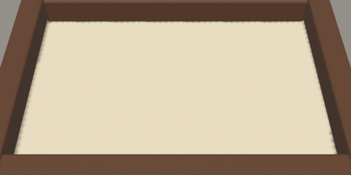
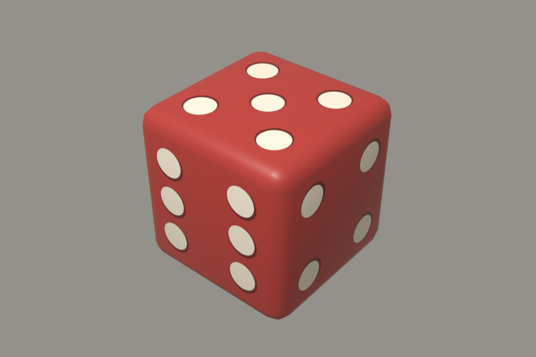
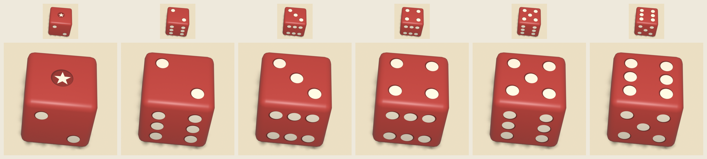
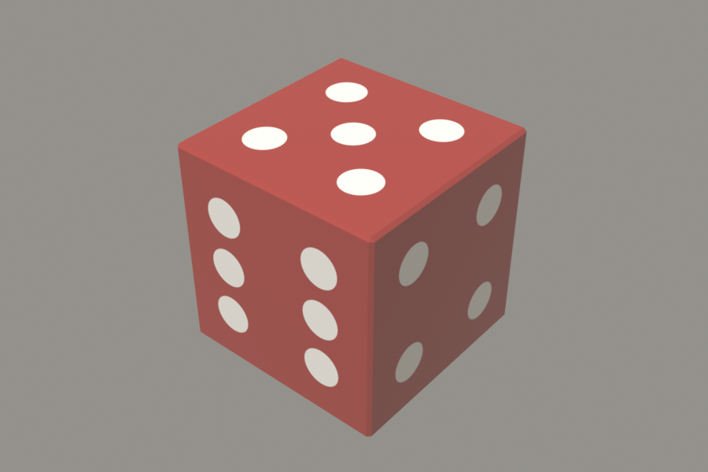
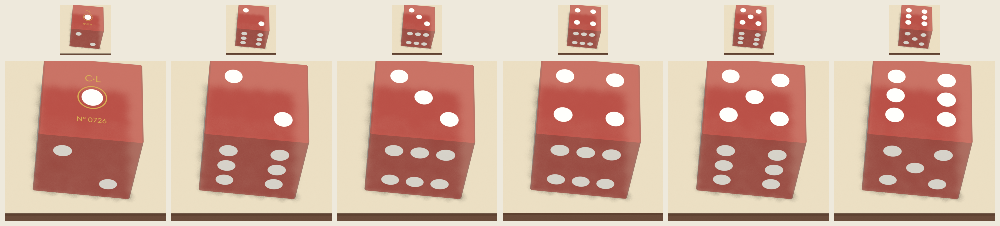
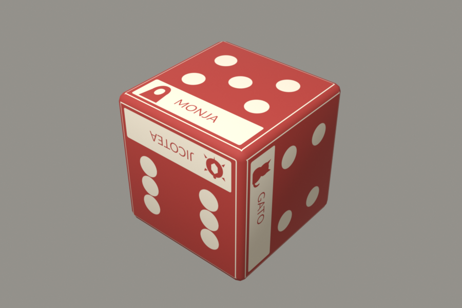
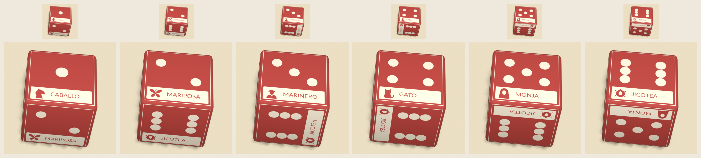

# Kidnap die and tray alternatives

These are decision-only studies for [#67](https://github.com/joeloverbeck/cuba-libre-unfolded/issues/67), part of spec [#58](https://github.com/joeloverbeck/cuba-libre-unfolded/issues/58). The owner chooses among them in #58's combined design round (#68). Nothing here is adopted, and nothing changes in production: no runtime code, save, admission manifest or hash file reads these files.

**Authority and constraints.**
- **[ADR 0001](../../../docs/adr/0001-baked-die-tumbles-land-on-the-committed-face.md):** a baked Blender tumble is exported as glTF. A static child rotation turns the committed face up, and playback seeks from the shared clock.
- **[The Kidnap die study](../../../docs/research/kidnap-die-presentation.md):** the three directions and the legibility floor (a landed top face of about 70 px at 1920×1080).
- **[Foundation 4](../../../docs/foundation/04-art-and-assets.md):** Blender for modelled assets, VectorCraft for graphics, FigCraft for layouts, and three equally serious alternatives.
- **[`docs/agents/art-tools.md`](../../../docs/agents/art-tools.md):** the animated-mesh checks.

**Rules basis.** Kidnap is a 26July Special Activity: "Roll a die and transfer to 26July…" (R 4.3.3). The game box has three dice: red, yellow and green (R p.2). That the die takes the rolling faction's colour, red for 26July, is accepted local policy from the study. The rules themselves give dice no faction.

## The probe

The two-hour probe passed. Its record, with Blender version, settings and outcome, is on #58: [comment 6931615409](https://github.com/joeloverbeck/cuba-libre-unfolded/issues/58#issuecomment-6931615409).

## What all three dice share

- **Size and frame:** a 16 mm cube, simulated at true size. Face 1 is up at Blender +Z, opposite faces sum to 7, and the die is right-handed (1, 2, 3 run counter-clockwise around their shared corner).
- **Structure:** each GLB holds one root node, **Die tumble**, which carries every clip. Its child, **Die body**, is the textured mesh and has no animation.
  - The runtime turns the committed face up by setting Die body's rotation, one of the cube's 24.
  - Of the four rotations that show a face, it should pick the one whose art reads upright toward the camera. Every preview here makes that choice, which is what keeps Charada captions and the casino monogram readable.
- **Faces:** one 1536×1024 atlas per die, three columns by two rows of 512 px cells, faces 1–3 on top and 4–6 below. Each is a VectorCraft artboard in `kidnap-die-faces.vectorcraft`. All use 26July red `#b43c36`, the palette's existing faction colour.
- **Tray:** `kidnap-tray.glb` is a flat tray with a 96 × 64 mm inner floor (6 × 4 die widths), a linen floor and low walnut walls, 10 mm high and 8 mm thick.
  - The tumbles were simulated against 25 mm walls. No clip comes within 4.4 mm of any wall on any frame, so the lower visual wall changes nothing in the motion. It keeps the oblique views clear.
  - The tray size follows from the legibility floor: at 70 px per die width, a tray much wider than 6 die widths cannot fit in a screen region outside the map.
- **Four tumbles:** `Tumble A` to `Tumble D`, baked once and shared by all three dice. The collider is the same Box, so the motion is identical. Every clip can present all six faces (see the Bevy check below).
- **Duration:** the die enters from above the tray, bounces once or twice and settles. Motion lasts 0.32–0.38 s, followed by a 0.75 s identical-key rest tail, so each clip runs 1.07–1.13 s. That is physically right for a 16 mm die that never touches a wall, but it is brisk. A longer roll would need a larger tray, which the legibility floor rules out, or slowed time. Slowed time is a possible owner request; it is not proposed here.

## The dice

Each die has:
- a tumble GIF of all four clips, in the sea-corner framing at its real 1920×1080 pixel size (600×300);
- a face sheet: each face landed by Tumble A, at 1× (top row, actual pixels) and at 3.2× (bottom row, roughly the owner's 6144×3456 display);
- a close-up.

### A — Box die, faction-cast (recommended)

 

`a-box-die.*`: an opaque cast die like the game's own, in 26July red, with softened 1.6 mm edges. Its cream pips sit in recesses; a dark rim drawn on the top-left reads as their shadow. The 1 is the only faction accent: a cream five-point star in a recessed disc, echoing the 26July standing emblem.

- **Legibility:** the best of the three. The pips are about 18% of the face, and every face reads at 1×. The star 1 reads as a single mark, never as a pip count.
- **Information density:** the lowest; the die shows only the number.
- **Atmosphere and tone:** plain and functional, like the physical game's component. The star ties it to 26July without decoration. It has the least period flavour of the three.
- **Following the faction:** recolour the body, with the star or another emblem on the 1. Government has no box die, so it would need an invented colour.

### B — Havana casino precision die

 

`b-casino-die.*`: a translucent cellulose-look red body (84% opaque) with razor edges and flush white pips. The 1 face carries an invented gold house monogram, **C·L**, a gold ring around the pip, and the serial **Nº 0726**, a nod to 26 July.
- **Invented marks only:** no real casino or dice-maker name or mark. "C·L" names no real house. The Havana provenance of such dice is itself unproven (study).
- **Material:** glTF `alphaMode: BLEND`, back faces culled. Hidden-face pips therefore never show through, and the tray shows faintly through the body instead.

- **Legibility:** good. The pips are white on a lighter, translucent red, so their contrast is slightly lower than A's. The monogram and serial are decorative and unreadable at 1×; at 3.2× they read.
- **Information density:** medium; the monogram and serial add a second, decorative layer on one face.
- **Atmosphere and tone:** the most glamorous: 1950s Havana casino money, which Kidnap literally takes, since it closes Casinos and takes Syndicate Cash (R 4.3.3). The gambling-den glamour sits a little oddly beside a kidnapping.
- **Risks to test in production:**
  - Bevy's alpha blending and sorting for a translucent tumbling die. Only Blender EEVEE renders are shown here.
  - Contrast for the yellow and green factions.

### C — Charada die

 

`c-charada-die.*`: an opaque red die, printed matte, with a thin cream frame on each face.
- **Pips:** the dominant cream pip group fills the upper two-thirds of each face.
- **Figure band:** below it, a cream band carries a small original silhouette and its *charada* name: 1 CABALLO, 2 MARIPOSA, 3 MARINERO, 4 GATO, 5 MONJA, 6 JICOTEA (the EcuRed list the study cites).
- **The figures** are drawn in VectorCraft as original silhouettes, nothing copied: horse head, butterfly, sailor bust, sitting cat, veiled nun, turtle.

- **Legibility:** pips still decide the result. They are 15% of the face, smaller than A's and confined to the upper area. At 1× the band reads as a light stripe, and the figures and words are only texture. At 3.2× the captions are readable, so the figures are a bonus for the owner's display, not a requirement.
- **Information density:** the highest: number, figure and word on every face.
- **Atmosphere and tone:** the most Cuban and the most narrative, from the bolita and *charada* of 1950s Havana, which the playbook ties to Trafficante (card 48 note). Bolita is drawn, not rolled, so the theme is a stretch.
  - **Owner judgment needed:** MONJA (nun) in a gambling image beside a kidnapping.
  - **Variant:** figure 4 varies between sources (cat, or cat-mouth); GATO was chosen.
- **Following the faction:** recolour the body or the ink; the figures are unchanged.

### Recommendation for the die

I recommend **A**, the box die. It is the clearest at the game's real 1× scale, it has the fewest production risks (opaque, no small text), and its single star accent reads as 26July.
- **C** is the better choice if atmosphere matters more than a clean 1× read. Its figures reward the owner's large display.
- **B** has the strongest single image, but it adds translucency risk in Bevy and a tone question.

## The tray placements

`kidnap-tray-placements.figcraft` holds three 16:9 frames for the owner's 6144×3456 display, 3.2× of 1920×1080, with the accepted top display in place. Each frame contains:
- **Context:** a locked, reference-only crop of a native 3840×2160 seat capture in the map area. It comes from `local/verification/issue-46/seat-top-16x9/rest.png` and is not a design.
- **The tray viewport:** its own Camera3d, framed independently of the map camera. The image placed in it is a Blender render of the landed box die at that framing.
- **The result text:** where it appears on landing or skip, naming the faction.

The exports are at half size: [A](tray-a-sea-corner.png) · [B](tray-b-bottom-band.png) · [C](tray-c-action-panel.png). All three keep the four standings and the Resources ledger visible. None puts the tray on the map relief or under region picks.

| | Viewport at 1920×1080 | Camera elevation | Landed top face (Tumbles A–D) |
|---|---|---|---|
| **A — sea corner** | 600×300, lower-left sea of the map viewport, below Pinar and above the legend | 50° | 70–83 px |
| **B — bottom band** | 880×270, the empty band between the card and session panels | 40° | 68–79 px (foreshortened edge 62–74 px) |
| **C — action panel** | 420×320, inside the operation panel under its title, with the result text below | 80° | 70–74 px |

The face size is the square root of the projected area of the landed top face, measured in Blender at the stated viewport. The second figure for B is its shortest projected edge.

- **A, sea corner.**
  - **For:** the roll happens beside the island, so the eye barely moves from the map.
  - **Against:**
    - It covers sea and could cover pieces if the player pans the map under it. It must not take picks, and the map may need to keep that corner clear while rolling.
    - A has the most map clutter around the die.
- **B, bottom band.**
  - **For:** it uses space the current layout leaves empty, and it covers nothing.
  - **Against:**
    - The low camera foreshortens the face; the borderline 68 px for Tumble D is the weakest legibility of the three placements.
    - It is the farthest from the operation panel, where the Kidnap decision is made.
- **C, action panel (recommended).**
  - **For:** the roll appears where the player just clicked Roll. The near top-down camera shows the face flat and upright, and the result text sits directly under it.
  - **Against:**
    - The panel is only 420 px wide at 1920×1080, which leaves almost no margin over the 70 px floor.
    - While the die rolls, the panel's other content (the preview text) must be replaced or collapsed.

## Admission checks

Every clip was checked on every frame by `local/verification/issue-67/blender/build.py`, run headless in Blender 5.2.3 LTS. The script and its logs are kept out of Git, as `art-tools.md` requires.

| Clip | Seed | Keys (s) | Starts at | Rest tail | Max rotation between keys | Landed face | Tilt | Min wall clearance | Interpenetration (A, B, C dice) |
|---|---|---|---|---|---|---|---|---|---|
| Tumble A | 6 | 65 (1.067) | 0 | 45 identical keys | 70.2° | 1 | 0.066° | 7.1 mm | none, none, none |
| Tumble B | 9 | 69 (1.133) | 0 | 45 | 55.9° | 6 | < 0.001° | 4.5 mm | none, none, none |
| Tumble C | 19 | 67 (1.100) | 0 | 45 | 61.0° | 2 | < 0.001° | 10.2 mm | none, none, none |
| Tumble D | 38 | 69 (1.133) | 0 | 45 | 71.2° | 3 | < 0.001° | 8.8 mm | none, none, none |

- **Flat, one face up:** the landed face's normal is within 0.07° of up, and the resting centre is at 8.000 mm.
- **No wall contact:** clearance from all four inner wall planes, on every frame.
- **Rotation bound:** every step between keys is under 90°, well under the 180° at which short-way slerp would reverse a spin.
- **Starts at 0, channels only on the tumble node:** each GLB has four animations, `Tumble A` to `Tumble D`. Each has exactly two LINEAR channels, translation and rotation, both on **Die tumble**, with input times starting at 0.
- **Landed face recorded:** the face that is up at the last key when Die body has identity rotation.
- **Interpenetration (art-tools):**
  - On every frame, the world-space BVH overlap of each die's own mesh, bevels included, against each tray part is empty.
  - Contact tolerance: the die is shrunk by 0.05 mm per face, because resting face-to-floor contact is coplanar. The deepest floor penetration of these clips is 0.0104 mm.
- **Negative controls:**
  - **Visual floor raised 4 mm:** flagged on 52 of Tumble A's 65 frames.
  - **From the probe:**
    - a lowered floor collider is flagged by both the overlap and floor-height checks;
    - keys thinned to every 8th frame fail the rotation bound at 162° and 174°.
  - **During selection:** of 40 seeded throws, 30 were rejected: 29 that came within 2 mm of a wall and others for the rotation bound, tilt or rest. Some throws failed more than one check.
- **Seam:** n/a, because a tumble does not loop.
- **Bevy 0.20:** a throwaway, never-committed example, built against the crate's `tabletop` build in a private target directory (`local/target-issue-67`). The source is kept as `local/verification/issue-67/bevy/die_probe.rs` and the logs under `local/verification/issue-67/bevy-private/`.
  - **What was played:** each of the 3 GLBs × 4 clips, through Bevy's own glTF loader, windowless, on a manual 1/60 s clock.
  - **24 rotations each:** every face with each of its four yaws, set as Die body's static rotation under a yawed placement.
  - **How the clip was driven:** `play().pause()`, then `set_seek_time(min(now − start, duration))` before `AnimationSystems`.
  - **Results, in all 12 runs:**
    - The Die tumble pose matches the GLB keys, read independently of the loader, within 7e-8.
    - The pose holds after the end.
    - Every target face ends up. The face is identified from its art (the atlas cell under the upward vertices' UVs), and its world-up component is at least 0.9999992 (0.07°).
    - So every clip can present all six faces.
  - **Negative control:** the same rotation on the *parent* fails 1,840 checks (min up −0.99).

## Honest limits

- **Blender renders, not native captures.** EEVEE under one sun and a desk-coloured world, Standard view transform. Bevy's lighting, alpha blending (B) and anti-aliasing will differ. The GIFs are limited to 256 colours.
- **Bake operator:** `rigidbody.bake_to_keyframes` cannot run headless. The simulated cache was instead keyed frame by frame onto Die tumble, one key per 60 fps frame. The result is the same baked keyframes, but the operator itself was not used.
- **The rest tail is held** from the first frame within 0.05 mm and 0.2° of the final simulated pose. The hold is invisible at any display size.
- **The placement frames show a landed still,** not motion. Context outside the tray (map, panels) is a capture or the accepted layout's locked rectangles.
- **Not established:**
  - native playback;
  - the frame-rate feel of a 0.35 s roll;
  - whether four clips avoid visible repetition;
  - the owner's acceptance of any look.

## Sources and provenance

- **`kidnap-die-faces.vectorcraft`:** the three face atlases (artboards 1–3), drawn through the VectorCraft MCP (VectorCraft 0.24.1). They are exported at scale 1 as `a-box-die-faces.png`, `b-casino-die-faces.png` and `c-charada-die-faces.png`.
- **`kidnap-dice.blend`:**
  - **Scene and collections:** scene `Kidnap_Dice`, with the collections `Box_die`, `Casino_die`, `Charada_die` and `Kidnap_Tray`.
  - **Animation:** each die's Die tumble carries the four tumbles as NLA tracks.
  - **Images:** the face atlases are referenced beside it (`//…-faces.png`).
  - **Construction:** Blender 5.2.3 LTS built it mechanically through its Python API, operated as an external editor. No generator script is part of the repository.
- **The exports:**
  - `a-box-die.glb`, `b-casino-die.glb` and `c-charada-die.glb`, each with one embedded face atlas and four animations;
  - `kidnap-tray.glb`, static.
- **Bake settings** (as in the probe):
  - 60 fps, 120 substeps and 60 solver iterations;
  - die 5 g, friction 0.5, restitution 0.7;
  - tray friction 0.7, restitution 0.5;
  - Box colliders, 0.2 mm margins, real gravity;
  - throws released 90–130 mm above the floor.
- **`kidnap-tray-placements.figcraft`:** made with FigCraft 0.18.1. Its frames are copied from the accepted `../../atlas/atlas-top-display.figcraft`, which is not modified.
- **No borrowed art:** no Pictures-collection art, board art, box art, real casino mark or dice-maker mark was used.
