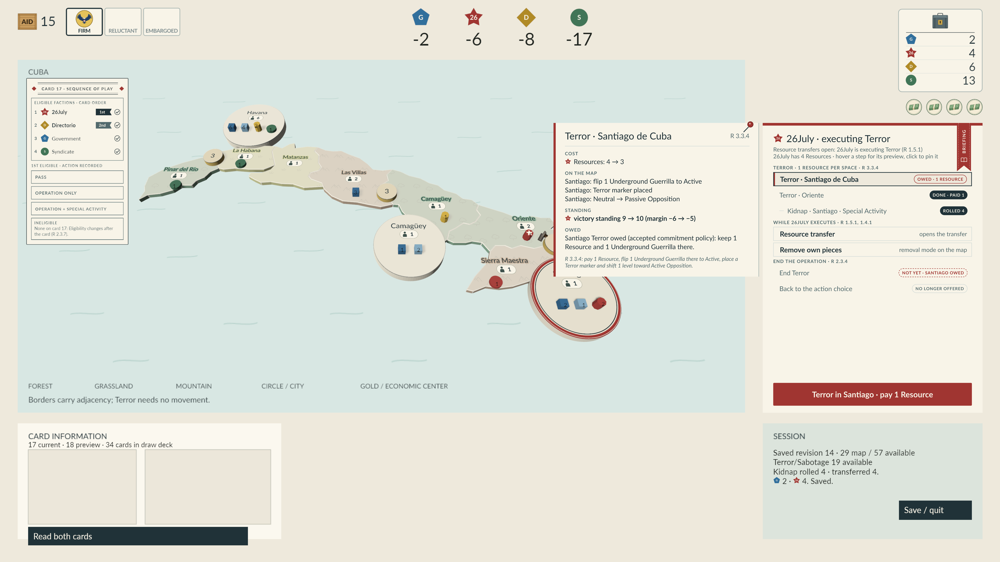
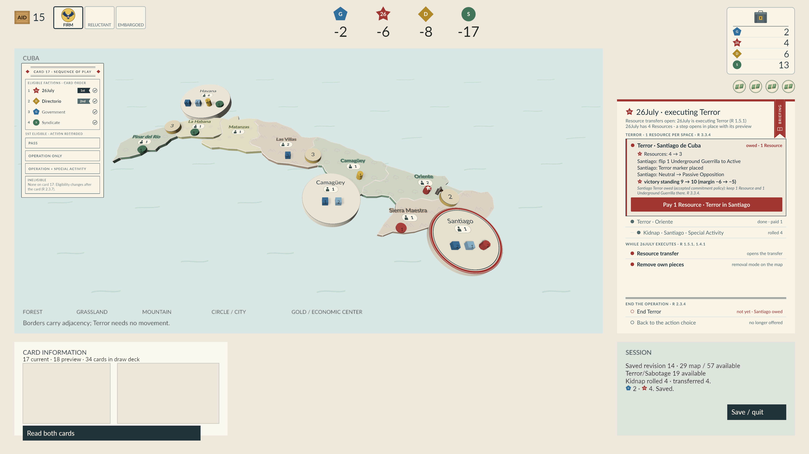
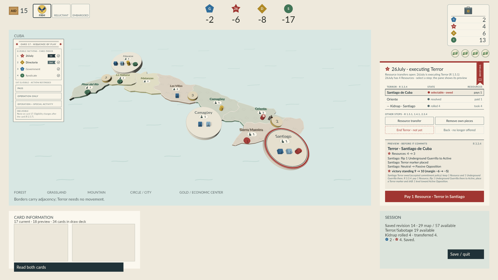

# Execution panel during Terror: three alternatives

> **Note (2026-11-18, #50):** this record takes the owner's display to be 6144×3456. It is 3840×2160 ([foundation 4](../../../docs/foundation/04-art-and-assets.md)), so pixel sizes given here at 6144×3456 or "owner scale" are 1.6 times what it shows.

These are decision-only studies for [#83](https://github.com/joeloverbeck/cuba-libre-unfolded/issues/83), part of spec [#58](https://github.com/joeloverbeck/cuba-libre-unfolded/issues/58). The owner chooses one, or rejects all three, in a round of at most 10 minutes; #84 builds the selection. Nothing here is adopted, and nothing in production changes: no runtime code, save, admission manifest or hash file reads these files.

**Why.** #75's end-to-end run found that during Terror execution the panel is still the interim button stack (`src/tabletop/operation.rs`) with the interim hover preview card (`src/tabletop/preview.rs`). Both are `WORK-2` bootstraps whose records expired before #75, and no selected design covers them: #64's AC-B left the execution panel as a placeholder. This round replaces both.

**Authority and constraints.**
- **[Foundation 4](../../../docs/foundation/04-art-and-assets.md):** three competent, distinct alternatives; FigCraft for layouts and VectorCraft for graphics; the `.figcraft` source owns structure, placement, size and spacing; a 16:9 frame for the owner's 6144×3456 display.
- **[`docs/agents/art-tools.md`](../../../docs/agents/art-tools.md):** the animated-mesh checks do not apply, because nothing here moves.
- **Fits the selected designs** ([#68 selection](https://github.com/joeloverbeck/cuba-libre-unfolded/issues/58#issuecomment-6940684089)), all in production under `art/atlas/` and reused without being redrawn:
  - **AC-B** (`atlas-action-choice.figcraft`): the panel's place and size (500×660 at the 1920×1280 reference), its red bar, the BRIEFING ribbon hanging from the top edge, the full-width primary action at the foot, the 26July tag plate, the pushpin, the option row, pill and section-label styles;
  - **the die-presented frame** (tray C, #74's merge, `KIDNAP.md`): used unchanged in all three, because the tray's full panel width is set by the 70 px landed-face floor;
  - **HF-A** (`atlas-popover.figcraft`): the four row marks (selectable, not yet, unavailable, done) and the remedy chip;
  - **TM-B** (`atlas-transfer.figcraft`): Resource transfer opens the TM-B modal; the pending request keeps TM-B's top-band tab and the giver's colour;
  - **EL-A** (`atlas-eligibility.figcraft`): untouched in the left margin.
- **Palette and type:** only the `Atlas` colour variables (`ink`, `ink-secondary`, `paper`, `desk`, `rule`, `action/primary`, the faction colours) and Lato, at AC-B's sizes. New text styles `Execution/*` record the few new sizes.
- **No new graphic** is drawn; every mark, plate and emblem is an accepted export.

**Content.** Every text and value comes from the integration branch's observations: #75's run `local/verification/issue-75/run-20261117-110457/main/steps/` (revisions 1, 6, 7, 10, 11, 14, 15 and 18) at `ea11f45`, with the wording `c99151d` changed after #75's fix: End Terror's remedy "Resolve Santiago's Terror" while Santiago's Terror is owed. Briefings stay general as the owner refined them, and space-specific results stay in the map popover; the panel's previews are the rules authority's own preview lines. Previews name factions by the accepted inline emblems where a line starts with one; mid-sentence names stay written out in the mockups, as #60's `Prose` turns them into emblems at runtime.

## What all three share

- **Frame:** a 3840×2160 seat capture of the integration branch at `ea11f45` (#75 run, `main/33-after-continue-owed-3840.png`, SHA-256 `557b3937…6a30`), scaled ×1.6 to 6144×3456, which puts the panel exactly where AC-B's 16:9 frame has it (1350×1782 at 4686, 756). The capture is context, not a design. Its card slots are blanked (below). Its session panel still shows the pre-`c99151d` notice "Kidnap rolled 4 · transferred 4"; the branch now says "Government pays 4 Resources to 26July".
- **The 16:9 state:** revision 14. Oriente's Terror resolved, Kidnap rolled 4, Santiago's Terror owed and selectable, End Terror refused while it is owed, Back to the action choice no longer offered, 26July has 4 Resources. Each alternative shows Santiago's preview before the committing click: 26July Resources 4 → 3, the flip, the marker, Neutral → Passive Opposition, standing 9 → 10 (margin −6 → −5).
- **Every alternative shows** the executing faction and "Resource transfers open: 26July is executing Terror (R 1.5.1)"; the Terror targets with their state (selectable, blocked with remedies, resolved); Kidnap open, then its stakes with Roll and Cancel; Resource transfer, which opens TM-B, and the pending request with its withdrawal; Remove own pieces (removal mode) and Done; End Terror with its preview and Directorio's options; Back to the action choice while it is allowed; the BRIEFING ribbon; and the die-presented frame.
- **States sheets,** eight states each, the same in all three: (1) Terror chosen at 0 Resources, targets blocked with remedies, Back offered; (2) End Terror's preview with nothing done (the zero-space warning); (3) Kidnap opened; (4) the die presented; (5) a Transfer request pending after Wait; (6) removal mode; (7) End Terror's preview after Kidnap (card 17's Event for Directorio); (8) End Terror refused while Santiago's Terror is owed, with its remedy.
- **Built at owner scale:** every size is the 1920×1280 reference ×2.7, as AC-B's frames are.

## EX-A — Pinned step tag

[Close-up at owner scale](ex-a-pinned-tag-closeup.png) · [states](ex-a-pinned-tag-states.png)

The action choice's own grammar, carried into execution. The panel is a fixed list of steps in AC-B's option rows: the two Terror targets, Kidnap beneath Terror on a connector, then Resource transfer and Remove own pieces, then End Terror and Back. Each row's state sits at its right as an AC-B pill: OWED · 1 RESOURCE (red outline), NOT YET (dashed red), DONE (ink), NO LONGER OFFERED (rule). Hovering or focusing a step opens its preview on the accepted 26July tag plate, 8 px left of the panel and top-aligned (AC-B's briefing-tag placement); a click pins it with the pushpin. The full-width primary action at the foot commits only the pinned step ("Terror in Santiago · pay 1 Resource") and is disabled with the reason when the pinned step is blocked. A blocked step's tag gives the reason and its in-task remedies as chips. Kidnap opened puts Cancel above Roll at the foot; the other steps dim until one is chosen.

- **Why it suits the task:** a player who has used the action choice already knows it: hover to read, click to pin, commit at the foot. Hovering never changes what the foot commits, so moving the pointer to the button cannot change the step.
- **Readability:** the best of the three for previews: the tag's lines are 40.5 px on the owner's display (15 at the reference) with a 1134 px measure, and each part has its caps label (COST, ON THE MAP, STANDING, OWED).
- **Information density:** the lowest in the panel, which keeps about a third of its height empty; the preview spends map area outside the panel.
- **Atmosphere:** the most consistent with accepted art: the tag plate, pushpin and pills are all AC-B's.
- **Trade-offs:**
  - the tag covers the map's east while it is open, including Santiago itself in the 16:9 frame, the space it previews; the owner accepted this for the action-choice briefing, and the camera can pan;
  - it competes with the space popover for the same place, so the #69 clash rule must extend to step tags: a space popover wins and the tag reopens from the row.

## EX-B — Docket in place

[Close-up at owner scale](ex-b-docket-closeup.png) · [states](ex-b-docket-states.png)

A docket of one-line steps, each led by its HF-A row mark, so the panel and the map popover speak one language. Choosing a step opens it in place: its preview lines appear under the row, on `desk` with a red marker, with that step's own commit button inside it ("Pay 1 Resource · Terror in Santiago"). Only one step is open; choosing another closes it. A blocked step opens to its reason and remedy chips, and a chip opens that step. End Terror and Back sit at the foot under a double rule, and End Terror opens upward from there. Kidnap opens to its stakes with Cancel and Roll side by side.

- **Why it suits the task:** the preview sits directly under the step it describes, and the button that commits is inside that preview, so what is read is what is committed. Nothing leaves the panel, so the map, including the previewed space, stays visible, and no clash rule is needed.
- **Readability:** good: steps 40.5 px, preview lines 37.8 px (14 at the reference), notes 31 px in italic. The measure is the panel's (about 1090 px), narrower than EX-A's tag.
- **Information density:** the highest in the panel: every step and the open preview are in one column.
- **Atmosphere:** a field docket; the HF-A marks tie the panel to the map's survey ink.
- **Trade-offs:**
  - rows below an open step move when it opens or closes;
  - long previews press on the space: End Terror's zero-space preview and the Kidnap stakes fill most of the panel (states 2 and 3), and a longer one would need the closed steps to shrink;
  - there is no single commit place: the button moves with the open step.

## EX-C — Ledger and preview pane

[Close-up at owner scale](ex-c-ledger-pane-closeup.png) · [states](ex-c-ledger-pane-states.png)

The panel splits in two at a fixed line. Above it is a ledger: a ruled table of the Terror targets and Kidnap (TERROR · STATE · RESOURCES), each with its HF-A mark and its Resources ("pays 1", "paid 1", "took 4", "needs 1"), then the other steps as a two-by-two grid of outlined buttons (Resource transfer, Remove own pieces, End Terror, Back). Below the line is a fixed preview pane on `desk`: it shows the selected row or button's preview, reason or stakes, always in the same place, and the primary action under it commits what the pane shows. Kidnap opened splits the foot into Cancel and Roll.

- **Why it suits the task:** the ledger reads like the game's own bookkeeping, every target's state and cost at a glance, and the pane never moves or covers the map. The commit is always in one place, under what it commits.
- **Readability:** good: ledger 40.5 px; pane lines 37.8 px (35.1 for long notes); notes 31 px.
- **Information density:** high and fixed: the whole Operation's bookkeeping is visible while a preview is read.
- **Atmosphere:** the most period: a ruled operations ledger with a docket slip below; the least like AC-B's list.
- **Trade-offs:**
  - the pane's height is fixed, so the longest previews just fit: the Kidnap stakes drop the "Cancel rolls nothing" note (the Cancel button says it), and anything longer would need a scroll or a smaller size;
  - the ledger is a new structure that #84 builds and tests besides AC-B's rows;
  - selecting and committing are two clicks in two places (row, then foot), as in AC-B.

## Recommendation (the proposer's)

**EX-A, the pinned step tag**, because it is the selected AC-B's own interaction carried through execution: the same tag, pin, pills and single commit at the foot, so the owner meets one panel grammar for the whole task, at the best preview legibility. Its cost is covering the map's east, including the previewed space, while a tag is open, and the clash rule must cover step tags too. **EX-C** is the better choice if covering the map is unacceptable and a fixed place for previews matters; **EX-B** if keeping each preview next to its step and its button matters most.

This is a proposal; the owner decides in #83's round, recorded on #58.

## Checks

- **Sources reopen:** after moving the files from the main checkout to this worktree, `execution-panel-layouts.figcraft` reopened from the worktree path with no repairs (FigCraft CLI 0.18.1: 1 page, 1816 layers, 39 embedded images) and rendered. Its `document.json` holds no absolute path. Its large embedded images are the blanked capture, AC-B's own card-panel crop (blank), its map and session crops and the tray render; both card-panel images were inspected zoomed: empty slots.
- **Exports inspected:** every 16:9 frame, close-up and states sheet was rendered and looked at; text fits its boxes at the stated sizes.
- **Card faces blanked:** the capture's two card slots were filled before anything was embedded or exported (`local/verification/issue-83/scripts/blank.py`, kept out of Git), including the strip of card that overhangs each slot's bottom border. The three 16:9 exports were cropped at the slots and inspected zoomed: both slots empty, no coloured pixel in either. The close-ups and states sheets contain no part of the card panel.
- **No production change:** the only files added are under `art/proposals/issue-83/`.
- **No borrowed art:** nothing from the Pictures collection. The context comes from this project's own seat capture.
- **Animated-mesh checks:** n/a; nothing here moves.

## Honest limits

- **Not native captures.** Layout, type and colour are FigCraft renders over a native capture; Bevy's text will differ.
- **The die-presented frame** is the accepted #74 export, unchanged, so it shows "26July rolls 5" while the 16:9 state follows a roll of 4.
- **The tag plate** is drawn at the accepted plate's size, stretched to its content; the runtime nine-slices it, as for the briefing tag.
- **Legibility at 6144×3456** is shown by the full-size exports, not on the owner's display (#16).
- **Export size:** about 13 MB of PNG for the three frames, three close-ups and three states sheets (the brief asked for about 10 MB); the capture-based 16:9 frames take 2.2–2.3 MB each.

## Sources and provenance

- **`execution-panel-layouts.figcraft`** (FigCraft CLI 0.18.1), started from a copy of `art/atlas/atlas-action-choice.figcraft` so that it keeps the `Atlas` variables, AC-B's text styles and its embedded accepted exports. Page **Execution panel (EX-A, EX-B, EX-C)**:
  - `EX-A Pinned step tag`, `EX-B Docket in place` and `EX-C Ledger and preview pane`: the 16:9 frames, each with a slice `close-up EX-…` for the close-up export;
  - `EX-A states`, `EX-B states` and `EX-C states`;
  - text styles `Execution/step label`, `Execution/step status`, `Execution/preview line`, `Execution/rule note` and `Execution/pane title`, beside AC-B's `Choice/*`, `Briefing/*` and `Tag/*`.
- **Embedded context:** the blanked capture (`local/verification/issue-83/base/owed-3840-blank.png`) and a crop of TM-B's pending tab from `main/17-after-wait-pending-3840.png`, both from #75's run at `ea11f45`.
- **Exports:** `*-16x9.png` at 6144×3456; `*-closeup.png` at owner scale (2944×1940, the panel and the map's east); `*-states.png` at 0.4× owner scale.

Constitution consulted (2026-11-15.1): `PURP-3`, `WORK-1`, `WORK-2`, `WORK-3`, `WORK-5`, `EVID-3`, `EVID-4`, `EVID-5`, `EVID-6`, `REP-2`, `OPS-1`, `OPS-3`, `OPS-4`, `OPS-5`, `AGENT-5`; foundation 4 and `docs/agents/art-tools.md`.
